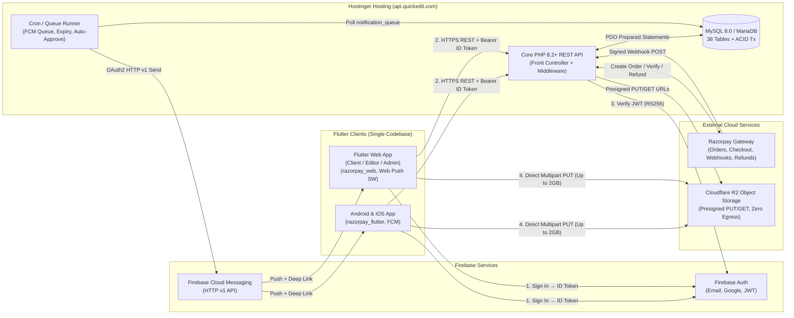
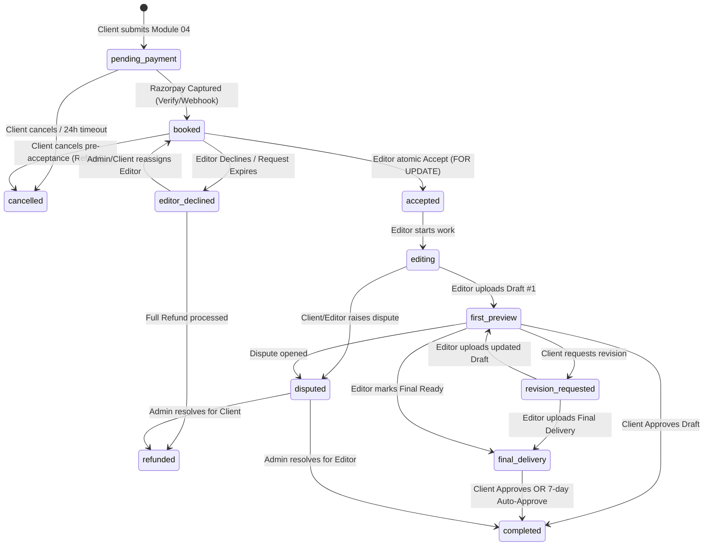

# QuickEdit — Complete End-to-End Technical Implementation Blueprint

**Version:** 1.0 (Production Architecture Specification)  
**Target Stack:** Flutter (Android, iOS, Tablet, Web/Desktop) · Core PHP 8.2+ REST API · MySQL 8.0 / MariaDB 10.6+ · Hostinger Web/Cloud Hosting · Firebase Auth & FCM HTTP v1 · Razorpay Payments · Cloudflare R2 Object Storage  
**Currency & Locale Baseline:** INR (`₹`), IST (`Asia/Kolkata`), extensible to multi-currency  

---

## 1. Executive Summary

**QuickEdit** is a two-sided video editing marketplace connecting content creators, brands, and individuals (**Clients**) with vetted freelance video editors (**Editors**), governed by a centralized **Admin** operations portal. The platform streamlines the full creative production lifecycle: editor discovery, portfolio previewing, structured service booking, large raw-footage uploads (up to 2 GB per file), server-verified Razorpay payments, milestone-based order tracking, draft previewing with structured revision cycles, final approval, automated ledger accounting, and admin-approved editor payouts.

This blueprint translates the 12-screen mobile UI reference into a production-ready, multi-platform technical architecture spanning **Android, iOS, Tablet, and Desktop Web** via a single Flutter codebase backed by a **Core PHP 8.2+ REST API** and **MySQL** database hosted on **Hostinger**.

### Core Architectural Pillars
1. **Strict Server-Side Authority:** Flutter never calculates authoritative prices, ledger balances, or role permissions. Every financial calculation, Razorpay order creation, HMAC-SHA256 payment/webhook signature verification, role check, and booking assignment lock executes server-side in PHP inside ACID MySQL transactions.
2. **Hostinger-Realistic Engineering:** Rather than assuming root SSH, persistent WebSocket daemons, Composer on the server, or unlimited PHP upload buffers, this design explicitly accounts for shared/cloud hosting limits ([Hostinger PHP Parameters](https://www.hostinger.com/support/4622479-how-to-change-values-of-php-parameters-in-hostinger/)). Large raw video files bypass PHP entirely via **direct-to-object-storage presigned PUT URLs** ([Cloudflare R2 Presigned URLs](https://developers.cloudflare.com/r2/api/s3/presigned-urls/)), and push notifications use a **MySQL-backed queue** processed via Hostinger Cron Jobs or a guarded HTTP cron endpoint.
3. **Regulatory & Financial Clarity:** While the UI reference displays a trust message ("Payment held safely by QuickEdit"), this blueprint explicitly distinguishes between **Razorpay payment capture**, **internal platform ledger accounting** (pending vs. available editor balances), and **regulated escrow**—preventing legal misrepresentation until a formal nodal/escrow banking arrangement is contracted.
4. **Adaptive Multi-Device UX:** Preserves the premium cinematic dark (`#101010`, `#171411`) + warm cream (`#FFF7E9`) + vibrant orange (`#F45116`) visual identity across mobile bottom-tab navigation, tablet two-column layouts, and desktop sidebar/multi-panel workspaces.

---

## 2. Product Requirements

### 2.1 Functional Requirements

| Domain | Requirement ID | Specification |
| :--- | :--- | :--- |
| **Identity & Access** | FR-01 | Firebase Authentication (Email/Password, Google Sign-In, Password Reset, Email Verification) synced with a MySQL `users` table via verified Firebase ID tokens. Server-enforced RBAC for `client`, `editor`, and `admin`. |
| **Client Discovery** | FR-02 | Home dashboard with featured/verified editors, service category shortcuts, full-text search, multi-facet filtering (verified, budget, delivery time, rating, specialization), sorting, and pagination. |
| **Editor Showcase** | FR-03 | Rich editor profiles with showreel header, verification badge, experience/project metrics, categorized video portfolio grid with inline playback, bio, specializations, and verified client reviews. |
| **Booking & Media** | FR-04 | 4-step booking flow (Service → Upload → Details → Payment) supporting 6+ service types, add-ons (rush delivery, extra revisions), drag-and-drop web uploads, mobile file picker, resumable/multipart uploads up to 2 GB/file, and server-side price computation. |
| **Payments & Accounting** | FR-05 | Server-created Razorpay orders, mobile (`razorpay_flutter`) and web (`razorpay_web`/JS) checkout, dual verification (client callback + independent Razorpay webhook), idempotency keys, refund handling, and double-entry style `editor_ledger`. |
| **Order Lifecycle** | FR-06 | Auditable state machine (`booked` → `accepted` → `editing` → `first_preview` → `revision_requested` → `final_delivery` → `completed` / `cancelled` / `disputed`), embedded preview video player, free vs. paid revision tracking, and post-completion star ratings. |
| **Editor Operations** | FR-07 | Editor dashboard with availability toggle, KPI cards, incoming job requests with concurrency-safe atomic accept/decline, project workspace (brief, reference links, files, interactive checklist, preview upload, project chat), schedule/calendar with conflict checks, and earnings/withdrawal portal. |
| **Support & Account** | FR-08 | Client/Editor directory view, threaded support tickets, notification preferences, multi-device FCM registration, profile management, and account deletion workflow. |
| **Admin Governance** | FR-09 | Dedicated responsive Flutter Web Admin dashboard covering 22 operational modules: analytics, user/editor management, KYC/verification approval, portfolio moderation, catalog/pricing/add-on management, bookings, payments, commissions, refunds, withdrawals, tickets, notifications, banners, reports, settings, and immutable audit logs. |

### 2.2 Non-Functional Requirements

- **Performance:** REST API p95 response latency `< 300ms` for read queries on Hostinger Business/Cloud; Flutter 60fps UI transitions; lazy-loaded video thumbnails and paginated lists (default 20 items/page).
- **Security:** TLS 1.3 HTTPS everywhere; PDO prepared statements exclusively; strict MIME & magic-byte validation; HMAC-SHA256 verification for Razorpay payments/webhooks; zero secrets in Flutter client bundles.
- **Reliability & Concurrency:** Atomic `SELECT ... FOR UPDATE` row locking on booking acceptance and withdrawal creation; idempotent webhook ingestion keyed by `webhook_event_id`; retryable notification queue.
- **Accessibility & Responsiveness:** WCAG AA (`>= 4.5:1`) text contrast; minimum `48x48dp` mobile touch targets; full keyboard navigation and hover/focus states on Flutter Web Desktop.

---

## 3. Reference Image Analysis

A screen-by-screen visual and functional audit of the 12 attached mobile reference screens (`WhatsApp Image 2026-11-18 at 10.56.43 PM.jpeg`):

| Screen # | Screen Name | Visual Theme & Layout | Key UI Components Observed | Production Engineering Notes & Refinements |
| :--- | :--- | :--- | :--- | :--- |
| **01** | **Client Home Dashboard** | Dark cinematic hero (`#101010`/`#171411`) with warm orange bokeh glow transitioning into dark/cream cards | `QUICKEDIT` split-color wordmark (`QUICK` white, `EDIT` `#F45116`), bell icon, avatar; hero headline ("Turn Your Ideas Into **Amazing Videos**"), search bar, 4 white service cards (`Quick Edit`, `Insta Reel`, `YouTube Short`, `YouTube Long`), horizontal `Top Verified Editors` carousel (Rohan Mehta ₹1,499, Priya Sharma ₹1,200) with 3 mini thumbnails each; 5-tab dark bottom nav (`Home`, `Explore`, `Orders`, `Chat`, `Profile`). | Add **Recently Viewed** and **Popular Editors** carousels below Top Verified Editors; ensure hero background uses an optimized WebP asset with dark scrim for contrast. |
| **02** | **Browse Editors** | Warm cream (`#FFF7E9`) surface with white (`#FFFFFF`) elevated cards | Back header (`Find Video Editors`), search input, horizontally scrollable filter chips (`✓ Verified` active orange, `Budget ▾`, `Delivery Time`, `Rating`), vertical list of editor cards showing avatar, blue verified checkmark, rating + review count, starting price, 4 portfolio thumbnails, specialization pills, completed project count, and `View Profile` button. | Mockup contains minor placeholder text (`1-2+ projects`, `3-4 projects`); production UI must bind strictly to `editor_profiles.completed_projects_count`. Add sort dropdown (`Popularity`, `Price: Low-High`, `Rating`) and availability badge. |
| **03** | **Editor Profile & Portfolio** | Dark cinematic showreel header (`#101010`) + warm cream/white body + sticky bottom CTA bar | Video showreel banner with play button, favorite heart & share icons, overlapping circular avatar, verified badge, `4.9 (128 reviews)`, 3-column stats (`120+ Projects`, `3+ Years exp.`, `2–3 days Avg. delivery`), underlined tabs (`Portfolio`, `About`, `Reviews`), portfolio filter pills (`All`, `Reels`, `YouTube`, `Brand Ads`, `Podcast`), 3×2 thumbnail grid with play overlays & view counts, `Specialisations` chip cloud, sticky bottom bar (`₹1,499 Starting price` + `Book this editor →`). | Implement lazy HLS/MP4 video modal player on thumbnail tap; persist favorites via API; render full bio/software stack in `About` tab and paginated verified reviews in `Reviews` tab. |
| **04** | **Create Booking / Upload Media** | Warm cream (`#FFF7E9`) with 4-step top stepper | Numbered stepper (`1 Service`, `2 Upload`, `3 Details`, `4 Payment`), 3×2 service card grid (`Quick Edit`, `Insta Reel` selected in solid `#F45116`, `YouTube Short`, `YouTube Long`, `Podcast Edit`, `Event Video`), dashed dropzone (`Drag & drop files here or Browse Files`, `MP4, MOV, AVI, JPG, PNG — Max 2GB each`), active upload progress list (`IMG_8921.MOV 320 MB`, `voiceover.mp3 12 MB`, `broll_clip.zip 850 MB`) with progress bars and cancel `×`, orange CTA `Continue to Details →`. | Step 3 (`Details`) captures project brief, editing instructions, reference links, deadline picker, and add-ons (Rush Delivery, Extra Revisions). Uploads stream directly to Cloudflare R2 via presigned URLs, not Hostinger PHP. |
| **05** | **Checkout & Payment** | Warm cream (`#FFF7E9`) with structured white cards | Editor summary card, itemized price breakdown (`Insta Reel Edit ₹1,999`, `Rush Delivery ₹500`, `Platform Fee ₹0`, `Total Amount ₹2,499`), amber trust callout with padlock, radio payment selector (`UPI` with GPay/PhonePe/Paytm, `Credit/Debit Card`, `Wallet`), orange CTA `Pay ₹2,499 Securely →`, footer trust badges (`100% Secure Payments`, `SSL Encrypted`). | **Important Legal Fix:** Reword the trust callout from "secured in escrow" to *"Payment protected by QuickEdit — funds are credited to the editor's withdrawable balance only after you approve the final delivery"* unless a regulated RBI nodal/escrow account is contracted. Actual payment collection executes inside Razorpay Checkout modal. |
| **06** | **Order Tracking & Review** | Warm cream (`#FFF7E9`) with status header and inline video player | Order summary card (`Insta Reel Edit`, `₹2,499`, green `In Progress` pill), horizontal 4-node timeline with timestamps (`Booked`, `Editing`, `First Preview`, `Delivering`), `Preview Video (1st draft)` player (`0:00 / 0:58`, fullscreen), `Revisions` card (`2 free revisions remaining`, `Request Revision` button), primary orange CTA `Approve & Release Payment`, extra revision pricing link, post-completion chat lock notice. | Expand timeline stepper to reflect all 7 lifecycle milestones (`Booked`, `Accepted`, `Editing`, `First Preview`, `Revision Requested`, `Final Delivery`, `Completed`). Trigger star rating + written review modal immediately upon `Approve & Release Payment`. |
| **07** | **Editor Dashboard** | Warm cream (`#FFF7E9`) with top bar and 5-tab editor bottom nav | `QUICKEDIT` header, greeting (`Good morning, Maya`), verified badge, `Available for work` orange toggle switch (`Online`), 3 KPI cards (`₹18,450 Earnings this month`, `12 Active projects`, `4.9 Rating`), 4 quick-action tiles (`New Job Requests`, `Calendar`, `Earnings`, `My Profile`), `Upcoming Deadlines` list with color-coded due times, 5-tab dark bottom nav (`Dashboard`, `Jobs`, `Calendar`, `Clients`, `Profile`). | Add `Recent Activities` feed below Upcoming Deadlines and verification-status banner (`Pending Review` / `Rejected` with resubmit CTA) for unverified editors. |
| **08** | **New Job Requests** | Warm cream (`#FFF7E9`) with filter tabs and action cards | Filter pills (`All (3)`, `Reels (1)`, `YouTube (2)`, `Sort ▾`), job cards displaying service thumbnail, title, payout/budget, duration, posted timestamp, priority badge (`▲ Urgent`, `▲ High Priority`), client avatar/rating, brief excerpt, and dual buttons (`Decline` outline, `Accept` solid `#F45116`). | Add request expiration countdown timer, reference-file preview count, and mandatory decline-reason bottom sheet/dialog. `Accept` calls atomic locking endpoint to prevent race conditions. |
| **09** | **Project Workspace** | Warm cream (`#FFF7E9`) with 4 workspace tabs and sticky bottom actions | Header (`Insta Reel Edit`, `In Progress`), client strip (`Maya Patel`, `Order #QE2457 • ₹1,200`), 4 tabs (`Overview`, `Files`, `Revisions`, `Messages`), deadline banner (`Today, 7:30 PM`, `5h 12m left`), `Project Brief`, clickable `Reference Link`, horizontal `Files (3)` cards (`raw_footage.mov 1.3 GB`, `brand_kit.zip 250 MB`, `music.mp3 12 MB`, `+ Add More`), interactive `Checklist`, dual bottom actions (`Upload Preview` dark `#171411`, `Mark as Ready` orange `#F45116`). | Enforce RBAC so only the assigned editor can toggle checklist items or upload previews, while the client can view files, request revisions, and exchange project messages. |
| **10** | **Editor Calendar / Schedule** | Warm cream (`#FFF7E9`) with horizontal week strip and hourly timeline | Header (`My Schedule` + dark `Today` pill), month/week selector (`Nov 2024`, Mon 11–Sun 17, active Thu 14 in `#F45116`), hourly schedule grid (`9 AM`–`6 PM`) with color-coded blocks (Orange = editing tasks, Warm beige = client calls, Dark `#171411` = podcast/priority edits, Gray = lunch/free time), full-width orange CTA `Set Availability`. | Add Month / Week / Day view switcher (essential for desktop/tablet) and server-side overlap validation when blocking slots or accepting rush jobs. |
| **11** | **Earnings & Withdrawal** | Warm cream (`#FFF7E9`) with vibrant orange hero earnings card | Header (`Earnings` + `This Month ▾` period filter), orange hero card (`Total Earnings ₹18,450` + bar graphic), 2-column ledger card (`Pending ₹7,200` | `Lifetime Earnings ₹2,84,500`), `Payout Method` card (`UPI` + masked bank/UPI ID + `Change`), orange CTA `Withdraw Earnings`, `Recent Transactions` list (`+₹2,499 Available`, `-₹10,000 Processed`). | Label pending funds as `Pending Clearance` (not regulated escrow). Display explicit breakdown of `Available Balance` vs `Pending Balance`, minimum withdrawal threshold (e.g., ₹500), and withdrawal status tracking (`Pending Admin Approval`, `Processing`, `Paid`, `Rejected`). |
| **12** | **Clients, Support & Account** | Warm cream (`#FFF7E9`) with segmented tabs | Header (`Clients & Support`), 3 segmented pills (`Active (2)`, `Completed (6)`, `Support`), `Recent Clients` cards (avatar, rating, order count, active service, due date, `View Project` CTA), bottom `Need Help?` support card (`Contact Support` button). | `Support` tab opens threaded ticket list + create ticket form. Pair with dedicated `Profile & Account Settings` screen (notification toggles, password reset, bank/payout details, logout, account deletion). |

---

## 4. Complete Feature Inventory

### 4.1 Client Application Modules (Modules 01–06 + Shared)
- **M01 — Client Home Dashboard:** Personalized greeting, global search, 4 core service category shortcuts, Top Verified Editors carousel, Recently Viewed Editors, Popular Editors, portfolio thumbnail previews, unread notification badge, role-aware navigation.
- **M02 — Browse Editors:** Keyword search (name, bio, specialization), filters (Verified only, Min/Max budget slider, Max delivery days, Min rating, Specialization chips, Availability), sort options (Popularity, Price Asc/Desc, Highest Rated), paginated editor cards with 4 portfolio previews.
- **M03 — Editor Profile & Portfolio:** Hero showreel video player, favorite/bookmark toggle, share deep link, verified badge, KPI stats (completed projects, years experience, avg delivery), categorized portfolio video gallery with modal playback, About tab (bio, tools like Premiere Pro/DaVinci Resolve/After Effects, languages), Reviews tab (star histogram + paginated reviews), sticky Book CTA.
- **M04 — Create Booking & Upload Media:** 4-step wizard: (1) Service selection (Quick Edit, Insta Reel, YouTube Short, YouTube Long, Podcast Edit, Event Video), (2) Multi-file upload (drag-and-drop web / file picker mobile, MP4/MOV/AVI/MP3/WAV/JPG/PNG/ZIP up to 2 GB/file, resumable progress, cancel/retry), (3) Brief, instructions, reference URLs, deadline date/time picker, add-ons (Rush Delivery, Extra Revisions, Subtitles, Color Grading), (4) Server-computed itemized summary.
- **M05 — Checkout & Payment:** Selected editor & service summary, transparent fee breakdown (Base + Add-ons + Rush Fee + Platform Fee − Discount + GST), Razorpay Checkout (UPI, Cards, Netbanking, Wallets), server-side signature verification, webhook synchronization, payment success/failure screens, retry flow, downloadable invoice summary.
- **M06 — Order Tracking & Review:** Real-time/polled order status timeline (7 states with timestamps & actor logs), embedded draft/final video player, revision counter (free vs. paid), structured revision request form (timecoded notes + optional reference upload), Approve & Release action, post-completion 5-star review & written feedback, chat auto-lock notice after completion window.

### 4.2 Editor Application Modules (Modules 07–12)
- **M07 — Editor Dashboard:** Greeting, KYC verification status banner, live `Available for work` toggle, monthly earnings, active projects count, average rating, 4 quick actions, upcoming deadlines sorted by urgency, recent activity feed.
- **M08 — New Job Requests:** Category/status filters, sort controls, urgency indicators (`Urgent`, `High Priority`, `Standard`), client info, budget (showing editor net payout after commission), deadline, brief preview, uploaded asset count, request expiry countdown, atomic `Accept` button, `Decline` modal with required reason.
- **M09 — Project Workspace:** 4 tabs (`Overview`, `Files`, `Revisions`, `Messages`), live deadline countdown, brief & external reference links, signed-URL file downloader for raw footage, interactive editor checklist, draft/final preview video uploader (direct to R2), `Mark as Ready` state transition, revision history thread, scoped project chat.
- **M10 — Editor Calendar & Schedule:** Day, Week, and Month calendar views, color-coded assigned project blocks, client call blocks, break/unavailable blocks, weekly recurring working-hours editor, specific date override/vacation blocks, overlap detection warning.
- **M11 — Earnings & Withdrawal:** Period filter (`This Month`, `Last 3 Months`, `This Year`, `All Time`), Total Earnings, Pending Clearance Balance, Available Withdrawable Balance, Lifetime Earnings, payout method management (UPI ID / Bank Account + IFSC), withdrawal request submission with server-side balance lock, withdrawal status timeline, full ledger transaction history.
- **M12 — Clients, Support & Account:** Active & Completed client rosters with order history & ratings, quick jump to project workspace, Support Ticket center (create ticket, attach screenshots, reply thread, status badges), Account Settings (profile edit, portfolio CRUD, notification channel preferences, password change/reset, logout, account deletion request).

### 4.3 Admin Panel (Module 13 — 22 Sub-Modules)
1. Admin Authentication (Firebase Auth + `admin` DB role + MFA recommendation)
2. Executive Dashboard Analytics (GMV, net revenue, active orders, editor supply, conversion)
3. Client Management (search, inspect orders, suspend/reactivate)
4. Editor Management (search, feature on home, adjust commission override, suspend)
5. Editor Verification & KYC Approval Queue (inspect ID/portfolio, approve/reject with reason)
6. Portfolio Moderation (flag/hide inappropriate or copyrighted thumbnails/videos)
7. Service Category Management (CRUD categories, icons, sort order, active toggle)
8. Pricing Management (global base price floors/ceilings, rush fee rules, tax/GST %)
9. Add-On Management (CRUD add-ons like Rush Delivery, Subtitles, Source Files)
10. Booking Management (filter all bookings, reassign editor on emergency, force cancel)
11. Order Status Management (inspect full audit trail, resolve disputes, override state)
12. Payment Management (Razorpay order/payment logs, webhook event inspector, manual reconciliation)
13. Commission Management (default platform commission %, per-editor custom tiers)
14. Refund Management (initiate full/partial Razorpay refunds, sync ledger deductions)
15. Withdrawal Approvals (review editor payout requests, verify bank/UPI, approve/mark paid with UTR reference, or reject & refund ledger)
16. Support Ticket Management (assign to admin staff, reply, change status/priority, close)
17. Notification Management (broadcast announcements, inspect failed FCM queue, manual retry)
18. Reviews & Ratings Moderation (hide abusive reviews, recalculate editor aggregates)
19. Promotional Banners & Discount Codes (CRUD home banners, coupon codes with expiry/usage limits)
20. Reports & Analytics (CSV exports for GST/accounting, revenue by category, editor SLA performance)
21. Platform Settings (key-value config: min withdrawal, auto-approval window, free revisions count, maintenance mode)
22. Immutable Audit Logs (filterable log of every sensitive admin/financial/status action)

---

## 5. User Roles and Permissions Matrix

Authorization is enforced strictly on the PHP backend via `RoleMiddleware` and resource-ownership policies (`BookingPolicy`, `ProjectPolicy`, `WithdrawalPolicy`). Client-supplied role claims are never trusted.

| Resource / Action | Client (`client`) | Editor (`editor`) | Admin (`admin`) | Ownership / Business Rule |
| :--- | :---: | :---: | :---: | :--- |
| Browse & search verified editors | Read | Read | Read / Write | Public catalog (read-only allowed pre-login for discovery) |
| Manage editor profile & portfolio | Deny | Own Only | Full | Editor edits own profile; Admin moderates/suspends any |
| Submit KYC verification | Deny | Own Only | Approve / Reject | Editor submits; Admin approves/rejects with audit log |
| Create booking & upload raw media | Create (Own) | Deny | Read / Update | Client must be active & email-verified |
| View booking & project workspace | Own Only | Assigned Only | Full | Enforced via `booking.client_id` or `booking.editor_id` |
| Accept / Decline job request | Deny | Assigned / Open | Override | Atomic DB lock prevents concurrent acceptance |
| Update checklist & upload preview | Deny | Assigned Only | Override | Client has read-only access to checklist & previews |
| Request revision / Approve delivery | Own Only | Deny | Override | Client only when status is `first_preview` or `final_delivery` |
| Project chat messages | Own Booking | Assigned Booking | Read / Moderate | Locked automatically after `completed` + grace window |
| Create Razorpay order & verify pay | Own Booking | Deny | Read / Reconcile | Server computes amount; webhook is final authority |
| Initiate Razorpay refund | Request Only | Deny | Execute | Admin approves & triggers Razorpay Refund API |
| View earnings & request withdrawal | Deny | Own Only | Full / Approve | Editor balance strictly computed from `editor_ledger` |
| Submit review & rating | Own Completed | Read Own | Moderate / Hide | One review per completed booking (`UNIQUE(booking_id)`) |
| Support tickets | Own Only | Own Only | Full | Users view/reply to own tickets; Admin manages all |
| Platform settings, services, banners | Read (Public) | Read (Public) | Full CRUD | All writes logged to `audit_logs` |
| Audit logs & webhook logs | Deny | Deny | Read Only | Append-only tables; no `UPDATE`/`DELETE` endpoints |

---

## 6. System Architecture

### 6.1 High-Level Architecture Diagram



### 6.2 Request Lifecycle & Data Flow
1. **Authentication Flow:** Flutter authenticates with Firebase Auth and obtains a short-lived JWT (`ID Token`). Every API request attaches `Authorization: Bearer <firebase_id_token>`. PHP `AuthMiddleware` verifies the signature, `aud`, `iss`, and `exp` claims, maps `firebase_uid` to `users.id`, verifies `users.status === 'active'`, and injects the hydrated user + role into the request context.
2. **Large Media Flow (Bypassing Hostinger PHP):** Flutter requests a presigned upload URL from `POST /api/v1/uploads/presign`. PHP validates MIME type, size, and booking ownership, inserts a `pending` row in `uploaded_media`, and returns a short-lived (15-minute) Cloudflare R2 presigned PUT URL (or multipart part URLs for files `> 100 MB`). Flutter uploads bytes directly to R2 with real-time progress, then calls `POST /api/v1/uploads/complete` so PHP verifies the object's `HEAD` metadata (`ETag`, `Content-Length`) and marks it `uploaded`.
3. **Payment & Financial Flow:** Client clicks Pay → PHP computes total from DB catalog (never trusting client totals) and creates a Razorpay Order → Flutter launches Razorpay Checkout → On client completion, Flutter sends `razorpay_order_id`, `razorpay_payment_id`, and `razorpay_signature` to PHP → PHP verifies HMAC-SHA256 signature and updates state → Independently, Razorpay POSTs signed webhooks (`payment.captured`, `payment.failed`, `refund.processed`) to `/api/v1/webhooks/razorpay` which act as the authoritative reconciliation source.
4. **Notification Flow:** Domain events (e.g., `BookingAccepted`, `PreviewUploaded`) insert a record into `notifications` (in-app history) and enqueue delivery jobs into `notification_queue`. A Hostinger cron job running every 1 minute (with an opportunistic inline trigger fallback for ultra-low latency on critical events) sends payloads via **FCM HTTP v1 API**, handles exponential backoff retries, and purges `UNREGISTERED` device tokens.

---

## 7. Technology Stack Justification

| Layer | Selected Technology | Justification & Production Trade-Offs | Official Reference |
| :--- | :--- | :--- | :--- |
| **Frontend UI** | **Flutter 3.24+ & Dart 3.5+ (Material 3)** | Single codebase for Android, iOS, Tablet, and Responsive Web/Admin. Pixel-accurate custom theming matches the cinematic dark/cream/orange aesthetic without platform drift. | [Flutter Docs](https://docs.flutter.dev/) |
| **State Management** | **Riverpod 2.x (`flutter_riverpod`)** | Compile-safe, testable, no `BuildContext` dependency, built-in `AsyncValue` for loading/error/data states, and automatic cache disposal per booking/editor screen. Superior to Bloc for rapid multi-screen CRUD without boilerplate bloat. | [Riverpod Docs](https://riverpod.dev/) |
| **Routing** | **GoRouter** | Declarative URL-based routing mandatory for Flutter Web (browser back/forward, bookmarkable `/editors/:id` and `/admin/*` URLs, deep links from FCM notifications, role-based route guards). | [go_router](https://pub.dev/packages/go_router) |
| **Networking & Models** | **Dio + Freezed + json_serializable** | Dio provides interceptors (auto-refresh Firebase ID token on 401, retry, upload progress callbacks). Freezed guarantees immutable models and safe JSON parsing. | [dio](https://pub.dev/packages/dio) |
| **Payments (Client)** | **`razorpay_flutter` (Mobile) + `razorpay_web` / JS Interop (Web)** | Official `razorpay_flutter` supports Android/iOS natively ([razorpay_flutter](https://pub.dev/packages/razorpay_flutter)); conditional Dart imports route Flutter Web to `razorpay_web` ([razorpay_web](https://pub.dev/packages/razorpay_web)) or Razorpay Standard Checkout JS (`checkout.js`). | [Razorpay Integration](https://razorpay.com/docs/payments/payment-gateway/web-integration/standard/integration-steps) |
| **Backend Runtime** | **Core PHP 8.2+ (Strict Types, OOP MVC/Service Layer)** | Natively supported on every Hostinger plan without container/VPS overhead. Zero framework lock-in, fast cold start, tiny memory footprint, and full control over `.htaccess` routing and PDO transactions. | [Hostinger PHP Hosting](https://www.hostinger.com/in/php-hosting) |
| **Database** | **MySQL 8.0 / MariaDB 10.6+ (InnoDB, `utf8mb4`)** | Native Hostinger support, ACID transactions, row-level locking (`FOR UPDATE`), `DECIMAL(12,2)` exact financial arithmetic, JSON columns for flexible metadata/audit diffs. | [Hostinger Pricing](https://www.hostinger.com/in/pricing) |
| **Identity & Push** | **Firebase Auth + FCM HTTP v1** | Offloads password hashing, OAuth, and token rotation to Google; free tier covers Email/Google Auth and unlimited FCM push notifications. Verified server-side via `kreait/firebase-php` ([beste/firebase-php](https://github.com/beste/firebase-php)) or zero-dependency OpenSSL RS256 fallback. | [Firebase Pricing](https://firebase.google.com/pricing) |
| **Large Media Storage** | **Cloudflare R2 (S3-Compatible)** | Video editing raw footage (300 MB–2 GB/file) will crash PHP shared hosting limits and incur massive egress bills on AWS S3. R2 offers **zero egress fees**, 10 GB free tier, and `$0.015/GB-mo` storage. | [Cloudflare R2](https://www.cloudflare.com/products/r2/) |

---

## 8. UI/UX and Design System

### 8.1 Color Tokens (`AppColors`)

| Token Name | Hex | Role & Usage | WCAG Contrast Pairings |
| :--- | :--- | :--- | :--- |
| `deepBlack` | `#101010` | Cinematic hero background, bottom nav bar, dark buttons, video player chrome | `#FFFFFF` (19.1:1), `#FFF7E9` (17.9:1) |
| `darkBackground` | `#171411` | Secondary dark surfaces, dark portfolio header, desktop dark sidebar | `#FFFFFF` (18.4:1), `#FF6B35` (6.3:1) |
| `primaryOrange` | `#F45116` | Primary CTAs, active nav pill, selected service card, progress nodes, urgent highlights | `#FFFFFF` (3.6:1 — use Bold 15–16pt+ / large text or `#101010` for small badges) |
| `secondaryOrange` | `#FF6B35` | Hover/gradient accents, secondary highlights, active chart bars | `#101010` (6.7:1) |
| `warmCream` | `#FFF7E9` | Primary scaffold background for all Client/Editor operational screens & forms | `#101010` (17.9:1), `#171411` (17.2:1) |
| `surfaceWhite` | `#FFFFFF` | Elevated cards, inputs, modal sheets, table containers on Warm Cream | `#101010` (19.1:1), `#595959` (7.0:1) |
| `mutedGray` | `#858585` | Secondary captions, timestamps, inactive icons, placeholders | Use `#616161` on `#FFF7E9` for body text to exceed 4.5:1 AA |
| `successGreen` | `#36A76A` | `In Progress`/`Available`/`Completed` badges, verified payouts, positive ledger amounts | `#FFFFFF` (3.1:1 — pair with tinted `#E8F7EF` bg + `#1B6E43` text for 6.1:1 AA) |
| `warningAmber` | `#F59E0B` | `High Priority` badges, trust callout border, deadline warnings (`< 6h`) | `#FFF8E7` bg + `#92400E` text |
| `errorRed` | `#DC2626` | `Urgent` badges, decline actions, payment failed, validation errors | `#FEF2F2` bg + `#991B1B` text |
| `verifiedBlue` | `#1D9BF0` | Verified Editor checkmark badge (matches reference Screens 01–03, 05, 07) | Icon-only on light/dark |

### 8.2 Typography Scale (`AppTypography`)
- **Display & Headings:** `Plus Jakarta Sans` (Weights: `600 SemiBold`, `700 Bold`, `800 ExtraBold`) — crisp geometric modern feel matching the hero headline (`Turn Your Ideas Into Amazing Videos`) and bold INR amounts (`₹18,450`).
- **Body & UI Controls:** `Inter` (Weights: `400 Regular`, `500 Medium`, `600 SemiBold`) — high legibility in dense tables, checklists, briefs, and forms.
- **Monospace (Order IDs, UTRs, Timestamps):** `JetBrains Mono` (`Order #QE2457`, `0:00 / 0:58`).

| Style Token | Mobile Size / Line Height | Desktop Size / Line Height | Weight | Usage |
| :--- | :--- | :--- | :--- | :--- |
| `displayHero` | `28sp / 1.15` | `40sp / 1.12` | `800` | Client Home hero banner headline |
| `headlineLarge` | `22sp / 1.25` | `28sp / 1.2` | `700` | Page headers, Earnings hero figure (`₹18,450`) |
| `titleLarge` | `18sp / 1.3` | `20sp / 1.3` | `700` | Section headings (`Top Verified Editors`, `Upcoming Deadlines`) |
| `titleMedium` | `16sp / 1.35` | `16sp / 1.35` | `600` | Card titles (`Rohan Mehta`, `Insta Reel Edit`) |
| `bodyMedium` | `14sp / 1.5` | `14sp / 1.5` | `400` | Descriptions, project briefs, reviews |
| `labelLarge` | `14sp / 1.2` | `14sp / 1.2` | `600` | Primary button labels, active tabs |
| `labelSmall` | `12sp / 1.2` | `12sp / 1.2` | `500` | Chips, timestamps, helper text |

### 8.3 Spacing, Radii, Elevation & Motion Standards
- **8pt Base Grid:** `xs=4`, `sm=8`, `md=12`, `lg=16`, `xl=20`, `2xl=24`, `3xl=32`.
- **Border Radii:** Cards `16dp`, Primary Buttons `14dp`, Filter Chips/Pills `999dp` (stadium), Inputs `12dp`, Bottom Nav Active Pill `12dp`, Modals/Bottom Sheets `24dp` top radius.
- **Shadows:** Subtle warm-tinted ambient shadow on cream surfaces: `BoxShadow(color: Color(0x0D171411), blurRadius: 16, offset: Offset(0, 4))`.
- **UI States (Mandatory on Every Screen):**
  - **Loading:** Shimmer skeletons matching exact card geometry (never bare centered spinners on full lists).
  - **Empty:** Branded minimalist illustration/icon + clear action CTA (e.g., *"No active projects yet — Browse Verified Editors"*).
  - **Error:** Non-destructive error card with human-readable message + `Retry` button + offline banner when connectivity drops.
  - **Success:** Animated checkmark modal/toast (`SnackBar` with `#171411` surface and `#36A76A` accent).
- **Motion & Micro-Interactions:**
  - Page transitions: `220ms` `Curves.easeOutCubic` fade+slide on mobile; instant/subtle `150ms` cross-fade on desktop web.
  - Button press scale: `0.97` over `100ms`; desktop card hover: `translateY(-2px)` + soft border tint `#F45116` at 30% opacity.
  - Animated KPI counters (`TweenAnimationBuilder`, `600ms`), smooth upload progress bars, and `Respect MediaQuery.disableAnimations` for accessibility & low-end devices.

---

## 9. Responsive Design Strategy

### 9.1 Breakpoint System

| Tier | Width Range (`dp` / `px`) | Target Devices | Navigation Pattern | Grid Columns | Content Max-Width |
| :--- | :--- | :--- | :--- | :---: | :--- |
| **Mobile** | `< 600` | Android, iOS phones | Dark 5-tab Bottom Navigation Bar | 1 col (2 col for compact service tiles) | `100%` (16px horizontal padding) |
| **Tablet** | `600 – 1023` | iPad, Android tablets, small laptops | Collapsible `NavigationRail` (72px) + Top Bar | 2 columns | `960px` |
| **Desktop** | `1024 – 1439` | Standard laptops, desktop browsers | Persistent Left Sidebar (240px) + Top Search/Action Bar | 3–4 columns | `1280px` |
| **Large Desktop** | `>= 1440` | Wide monitors, 4K displays | Persistent Left Sidebar (260px) + Top Bar + Inspector Panel | 4 columns / 12-col CSS-like grid | `1440px` centered |

### 9.2 Per-Module Responsive Adaptation Matrix

| Module | Mobile (`< 600px`) | Tablet (`600–1023px`) | Desktop / Large Desktop (`>= 1024px`) |
| :--- | :--- | :--- | :--- |
| **01 Client Home** | Full-bleed dark hero + 4-tile service row + horizontal editor carousel | Split hero (text left, visual right) + 4-col service cards + 2-col editor grid | Full-width cinematic hero banner (`max-w 1440`) + 6-col service cards + 3–4 col Verified/Popular editor grids with hover previews |
| **02 Browse Editors** | Top search + horizontal filter chips + 1-col editor cards | Sticky top filter bar + 2-col editor card grid | Persistent left filter sidebar (280px: Verified, Budget range slider, Delivery, Rating, Specializations) + 3-col editor grid |
| **03 Editor Profile** | Stacked showreel header + tabs + 3×2 portfolio grid + sticky bottom CTA | 2-col header + 3-col portfolio grid + floating CTA | 2-column layout: Left 65% (Showreel, Tabs, 3-col Portfolio, Reviews); Right 35% sticky Booking Summary & Starting Price card |
| **04 Create Booking** | 4-step full-screen wizard (one step at a time) | 2-step split or compact top stepper | 2-column split: Left 65% (Service grid, Drag-and-drop R2 dropzone, Details/Add-ons); Right 35% persistent live Order Summary |
| **05 Checkout** | Single-column breakdown + payment radio + bottom Pay button | Centered `640px` checkout card | 2-column split: Left 55% (Payment method & trust info); Right 45% (Itemized invoice, coupon code, editor summary, Pay CTA) |
| **06 Order Tracking** | Vertical stack: summary → timeline → video player → revision/approve | 2-col top summary + wide video player | 2-column workspace: Left 65% (16:9 Preview Video Player + Timeline); Right 35% (Revision panel, Approve CTA, Order Chat) |
| **07 Editor Dashboard** | Stacked KPI row + 4 quick tiles + deadlines list | 3-col KPI cards + 2-col deadlines & activity | Sidebar + 4-col KPI bar + 2-column body (Left: Active Projects data table; Right: Upcoming Deadlines + Availability toggle) |
| **08 New Job Requests** | Filter pills + stacked job cards | 2-col job request cards | Filter bar + 2–3 col grid OR Master-Detail split (List on left, full brief + reference files + Accept/Decline on right) |
| **09 Project Workspace** | 4 sub-tabs (`Overview`, `Files`, `Revisions`, `Messages`) + sticky actions | 2-col (Details/Files left, Messages/Revisions right) | 3-pane desktop studio: Left (Brief, Checklist, Deadline), Center (Files & Preview Uploader/Player), Right (Live Messages & Revisions) |
| **10 Editor Calendar** | Horizontal 7-day strip + hourly single-day timeline | Week view (7 columns) + side availability drawer | Full interactive Month / Week / Day calendar grid + right-hand Working Hours & Slot Editor panel |
| **11 Earnings & Withdrawal** | Orange hero card + 2-col pending/lifetime + payout + list | 2-col summary + wide transaction table | Top 4 KPI cards + 2-col layout (Left: Earnings chart + Paginated Transaction DataTable; Right: Payout Method & Withdrawal form) |
| **12 Clients & Support** | 3 segmented tabs + stacked client cards + support card | 2-col client cards + ticket drawer | Tabbed DataTable for Active/Completed clients; split-pane Support Inbox (ticket list left, live conversation thread right) |
| **13 Admin Panel** | Supported for urgent approvals (drawer nav + stacked cards) | NavigationRail + 2-col KPIs | Desktop-first: Dark `#171411` sidebar (grouped 22 modules) + Top bar + Multi-column KPI charts + Filterable DataTables + Side Inspection Drawers |

### 9.3 Adaptive Interaction & Accessibility Rules
- **Dialogs & Sheets:** Render as `showModalBottomSheet` on Mobile (`< 600px`) and centered `Dialog` (`maxWidth: 540px` or `720px` for media previews) on Tablet/Desktop.
- **Data Tables:** Horizontal scroll wrapper with pinned first column on Tablet; full responsive `PaginatedDataTable` with column sorting and CSV export on Desktop.
- **Media Aspect Ratios:** Portfolio thumbnails `16:9` (YouTube/Brand) or `9:16` (Reels/Shorts) inside clipped `AspectRatio` containers; video player caps height at `60vh` on desktop with keyboard shortcuts (`Space` play/pause, `F` fullscreen, `M` mute).
- **Touch & Keyboard:** Minimum `48×48dp` interactive targets on touch devices; full `FocusTraversalGroup`, visible focus rings (`2px #F45116`), and `Esc` modal dismissal on Web Desktop.

---

## 10. Flutter Architecture

### 10.1 Scalable Feature-First Project Structure

```text
quickedit_app/
├── lib/
│   ├── main.dart                         # Flavor bootstrap, Firebase init, ProviderScope
│   ├── app/
│   │   ├── app.dart                      # MaterialApp.router, theme, global listeners
│   │   ├── config/
│   │   │   ├── env_config.dart           # --dart-define API_BASE_URL, RAZORPAY_KEY_ID, ENV
│   │   │   └── app_constants.dart
│   │   ├── router/
│   │   │   ├── app_router.dart           # GoRouter config + role/auth redirect guards
│   │   │   └── route_paths.dart          # Typed route constants (/client/*, /editor/*, /admin/*)
│   │   └── theme/
│   │       ├── app_colors.dart
│   │       ├── app_typography.dart
│   │       └── app_theme.dart            # Material 3 ThemeData (warm cream + dark hero overrides)
│   ├── core/
│   │   ├── api/
│   │   │   ├── dio_client.dart           # Base Dio instance, timeouts, JSON headers
│   │   │   ├── auth_interceptor.dart     # Injects Firebase ID token, handles 401 refresh
│   │   │   ├── error_interceptor.dart    # Maps API errors -> typed AppException
│   │   │   └── api_response.dart         # Generic ApiResponse<T> & PaginatedResponse<T>
│   │   ├── auth/
│   │   │   ├── firebase_auth_service.dart
│   │   │   └── session_provider.dart     # Synced MySQL user profile + role state
│   │   ├── firebase/
│   │   │   └── firebase_options.dart     # Generated by FlutterFire CLI
│   │   ├── notifications/
│   │   │   ├── fcm_service.dart          # Permission, token registration, deep-link routing
│   │   │   └── local_notification_service.dart
│   │   ├── payments/
│   │   │   ├── razorpay_gateway.dart     # Platform abstraction interface
│   │   │   ├── razorpay_mobile.dart      # razorpay_flutter implementation
│   │   │   └── razorpay_web_impl.dart    # razorpay_web / JS interop implementation
│   │   ├── storage/
│   │   │   └── secure_storage_service.dart # flutter_secure_storage (mobile) / memory+session (web)
│   │   ├── responsive/
│   │   │   ├── breakpoints.dart          # Mobile <600, Tablet 600-1023, Desktop >=1024
│   │   │   ├── responsive_builder.dart   # Adaptive layout widget
│   │   │   └── app_shell.dart            # BottomNav (Mobile) vs Rail (Tablet) vs Sidebar (Desktop)
│   │   ├── errors/
│   │   │   └── app_exception.dart
│   │   ├── utils/
│   │   │   ├── currency_formatter.dart   # ₹1,499 Indian numbering format (intl)
│   │   │   └── date_formatter.dart
│   │   └── widgets/
│   │       ├── quickedit_logo.dart
│   │       ├── shimmer_skeleton.dart
│   │       ├── empty_state_view.dart
│   │       ├── error_retry_view.dart
│   │       ├── verified_badge.dart
│   │       └── video_preview_player.dart # video_player + chewie (mobile/web)
│   ├── features/
│   │   ├── authentication/               # data/, domain/, presentation/ (login, register, role onboarding, verify)
│   │   ├── client_dashboard/             # Module 01
│   │   ├── browse_editors/               # Module 02
│   │   ├── editor_profile/               # Module 03
│   │   ├── booking/                      # Module 04 (4-step wizard state)
│   │   ├── media_upload/                 # Direct-to-R2 multipart/presigned uploader
│   │   ├── checkout/                     # Module 05
│   │   ├── order_tracking/               # Module 06
│   │   ├── editor_dashboard/             # Module 07
│   │   ├── job_requests/                 # Module 08
│   │   ├── project_workspace/            # Module 09 (overview, files, revisions, chat)
│   │   ├── calendar/                     # Module 10
│   │   ├── earnings/                     # Module 11
│   │   ├── clients/                      # Module 12 (Active/Completed clients)
│   │   ├── support/                      # Module 12 (Tickets & messages)
│   │   ├── notifications/                # Notification center & preferences
│   │   ├── profile/                      # Shared account settings & editor KYC/portfolio editor
│   │   └── admin/                        # Module 13 (22 admin sub-features)
│   └── shared/
│       ├── models/                       # Freezed models: UserModel, EditorModel, BookingModel, etc.
│       └── components/                   # Reusable EditorCard, StatusPill, PriceBreakdownCard
├── web/
│   ├── index.html                        # Includes Razorpay checkout.js & meta tags
│   ├── firebase-messaging-sw.js          # Web Push background service worker
│   └── manifest.json
├── test/                                 # Unit, Widget, Responsive golden tests
└── integration_test/                     # End-to-end flows
```

### 10.2 Clean Layer Separation Inside Every Feature
Each folder under `lib/features/<feature_name>/` follows a strict 3-layer boundary:
- **`data/`**: `*_api_service.dart` (Dio calls returning raw DTOs) + `*_repository.dart` (maps DTOs to immutable domain models, handles caching/retries).
- **`domain/`**: `@freezed` models, enums (`BookingStatus`, `UserRole`, `PaymentStatus`), and pure business helpers.
- **`presentation/`**: Riverpod `AsyncNotifier` controllers (`*_controller.dart`), responsive `*_screen.dart`, and modular `widgets/` (keeping every widget under ~200 lines).

### 10.3 Core Pubspec Dependencies
- **State & Routing:** `flutter_riverpod`, `riverpod_annotation`, `go_router`
- **Networking & Serialization:** `dio`, `freezed_annotation`, `json_annotation`
- **Firebase:** `firebase_core`, `firebase_auth`, `google_sign_in`, `firebase_messaging`
- **Payments:** `razorpay_flutter` (mobile), `razorpay_web` (web conditional import)
- **Media & Files:** `file_picker`, `desktop_drop` (web/desktop drag-and-drop), `video_player`, `chewie`, `cached_network_image`, `mime`
- **UI & Utilities:** `google_fonts`, `shimmer`, `intl`, `url_launcher`, `flutter_secure_storage`, `table_calendar`, `fl_chart` (Admin & Editor earnings charts)

---

## 11. PHP Backend Architecture

### 11.1 Hostinger-Adapted Directory Structure

To prevent exposing `.env`, Firebase service-account JSON keys, logs, or source code via HTTP on Hostinger shared/cloud hosting, **only `public/` is mapped as the document root** of `api.quickedit.com` (or placed inside `public_html/api/` with all private folders one level above `public_html/`).

```text
quickedit-backend/                        # Deployed ABOVE public_html (e.g., /home/u123456/quickedit-backend/)
├── .env                                  # chmod 600; never committed to Git
├── .env.example
├── composer.json                         # Run locally; upload pre-built vendor/ if Hostinger plan lacks SSH/Composer
├── composer.lock
├── vendor/                               # Pre-vendored dependencies (kreait/firebase-tokens, aws-s3/r2 signer, razorpay)
├── public/                               # Document root for api.quickedit.com (symlinked or copied to public_html/api/)
│   ├── index.php                         # Single Front Controller (bootstraps app, routes request)
│   └── .htaccess                         # Clean URL rewrite, security headers, Authorization header passthrough
├── app/
│   ├── Config/
│   │   ├── Env.php                       # Loads .env into immutable config array
│   │   ├── Database.php                  # Singleton PDO factory (ERRMODE_EXCEPTION, EMULATE_PREPARES=false, utf8mb4)
│   │   ├── FirebaseConfig.php            # Service account path & project ID
│   │   ├── RazorpayConfig.php            # Key ID, Key Secret, Webhook Secret
│   │   └── StorageConfig.php             # Cloudflare R2 endpoint, bucket, access/secret keys
│   ├── Core/
│   │   ├── Router.php                    # Regex route matcher with path params & middleware stack
│   │   ├── Request.php                   # Parses JSON body, query, headers, Bearer token, authenticated user
│   │   ├── Response.php                  # Standardized JSON envelope & HTTP status emitter
│   │   └── ErrorHandler.php              # Global exception/error catcher -> sanitized JSON + file log
│   ├── Middleware/
│   │   ├── CorsMiddleware.php            # Strict origin whitelist for web/admin domains
│   │   ├── RateLimitMiddleware.php       # MySQL/APCu sliding-window IP & user rate limiter
│   │   ├── AuthMiddleware.php            # Verifies Firebase ID token -> hydrates MySQL user & role
│   │   ├── RoleMiddleware.php            # Enforces allowed roles (client, editor, admin)
│   │   └── AuditMiddleware.php           # Captures IP, User-Agent, actor for sensitive mutations
│   ├── Controllers/                      # Thin HTTP controllers (1 per domain + Admin/*)
│   │   ├── AuthController.php
│   │   ├── UserController.php
│   │   ├── EditorController.php
│   │   ├── ServiceController.php
│   │   ├── BookingController.php
│   │   ├── UploadController.php
│   │   ├── PaymentController.php
│   │   ├── OrderController.php
│   │   ├── ReviewController.php
│   │   ├── ChatController.php
│   │   ├── CalendarController.php
│   │   ├── EarningsController.php
│   │   ├── WithdrawalController.php
│   │   ├── NotificationController.php
│   │   ├── SupportController.php
│   │   └── Admin/
│   │       ├── AdminDashboardController.php
│   │       ├── AdminUserController.php
│   │       ├── AdminCatalogController.php
│   │       ├── AdminBookingController.php
│   │       ├── AdminFinanceController.php
│   │       ├── AdminOperationsController.php
│   │       └── AdminSystemController.php
│   ├── Services/                         # Business logic & ACID transaction orchestration
│   │   ├── FirebaseTokenVerifier.php     # kreait/firebase-tokens OR zero-dependency OpenSSL RS256 verifier
│   │   ├── FcmNotificationService.php    # Enqueues notifications + sends via FCM HTTP v1 OAuth2 cURL
│   │   ├── RazorpayService.php           # Order creation, signature verification, webhook verification, refunds
│   │   ├── PricingService.php            # Server-side price, add-on, discount, GST & commission calculation
│   │   ├── LedgerService.php             # Double-entry editor_ledger writes & balance computation
│   │   ├── R2StorageService.php          # S3-v4 presigned PUT/GET & multipart upload signer (zero SDK bloat)
│   │   └── AuditLogService.php           # Append-only audit_logs writer
│   ├── Repositories/                     # Pure PDO data-access classes (zero raw SQL in controllers)
│   ├── Validators/                       # Declarative input schema validators returning field-level errors
│   └── Helpers/                          # MoneyHelper (bcmath), UuidHelper, DateHelper
├── routes/
│   ├── auth.php
│   ├── users.php
│   ├── editors.php
│   ├── services.php
│   ├── bookings.php
│   ├── uploads.php
│   ├── payments.php
│   ├── orders.php
│   ├── reviews.php
│   ├── chat.php
│   ├── calendar.php
│   ├── earnings.php
│   ├── withdrawals.php
│   ├── notifications.php
│   ├── support.php
│   └── admin.php
├── cron/
│   ├── process_notifications.php         # CLI cron script: sends pending notification_queue rows via FCM v1
│   ├── expire_job_requests.php           # CLI cron script: expires unanswered booking requests
│   └── auto_approve_deliveries.php       # CLI cron script: auto-completes orders past 7-day client review window
├── database/
│   ├── migrations/                       # Numbered SQL files (001_users.sql ... 014_audit_logs.sql)
│   └── seeds/                            # 001_roles_and_services.sql, 002_dev_mock_editors.sql (DEV ONLY)
└── storage/
    ├── keys/                             # firebase-service-account.json (chmod 600, outside public/)
    ├── logs/                             # Daily rotating JSON logs (app-YYYY-MM-DD.log)
    └── uploads/                          # Small fallback assets only (avatars/thumbnails if R2 disabled)
```

### 11.2 Apache `.htaccess` for Hostinger (`public/.htaccess`)

```apache
<IfModule mod_rewrite.c>
    RewriteEngine On
    # Pass Authorization header to PHP-FPM / CGI on Hostinger
    RewriteCond %{HTTP:Authorization} .
    RewriteRule .* - [E=HTTP_AUTHORIZATION:%{HTTP:Authorization}]

    # Force HTTPS
    RewriteCond %{HTTPS} !=on
    RewriteRule ^ https://%{HTTP_HOST}%{REQUEST_URI} [L,R=301]

    # Route all non-file requests to front controller
    RewriteCond %{REQUEST_FILENAME} !-f
    RewriteCond %{REQUEST_FILENAME} !-d
    RewriteRule ^ index.php [QSA,L]
</IfModule>

<IfModule mod_headers.c>
    Header always set X-Content-Type-Options "nosniff"
    Header always set X-Frame-Options "DENY"
    Header always set Referrer-Policy "strict-origin-when-cross-origin"
    Header always set Strict-Transport-Security "max-age=31536000; includeSubDomains"
</IfModule>
```

### 11.3 Standardized API Response Envelope

**Success (`200 OK` / `201 Created`):**
```json
{
  "success": true,
  "message": "Booking created successfully",
  "data": { "...": "..." },
  "meta": { "page": 1, "per_page": 20, "total": 84, "total_pages": 5 },
  "request_id": "req_9f3a1c2d"
}
```

**Error (`400` / `401` / `403` / `404` / `409` / `422` / `429` / `500`):**
```json
{
  "success": false,
  "error": {
    "code": "VALIDATION_ERROR",
    "message": "One or more fields are invalid.",
    "details": { "deadline": ["Deadline must be at least 6 hours from now."] }
  },
  "request_id": "req_9f3a1c2d"
}
```

---

## 12. Complete API Endpoint Documentation

**Base URL:** `https://api.quickedit.com/api/v1`  
**Standard Headers (Authenticated):** `Authorization: Bearer <firebase_id_token>`, `Content-Type: application/json`, `Accept: application/json`, `X-Platform: android|ios|web`, `X-Idempotency-Key: <uuid>` (mandatory on booking creation, payment verification, and withdrawal creation).

### 12.1 Authentication & Account (`routes/auth.php`, `routes/users.php`)

| Method & URL | Purpose | Auth / Role | Request Body / Params | Validation & Processing Logic | Tables Affected | Success / Error & Notifications |
| :--- | :--- | :--- | :--- | :--- | :--- | :--- |
| `POST /auth/sync` | Sync Firebase user into MySQL after login/register | Firebase Bearer / Any | `{"desired_role":"client\|editor","full_name":"...","phone":"+91..."}` | Verifies Firebase ID token; extracts `uid`, `email`, `email_verified`. If new user, creates `users`, `user_roles` (strictly `client` or `editor`, **never** `admin`), and `client_profiles` or `editor_profiles` (`verification_status='draft'`). If existing, returns DB role (ignoring `desired_role`). | `users`, `user_roles`, `client_profiles`, `editor_profiles`, `notification_preferences` | `200`/`201` user profile + role + permissions. `401` invalid token, `403` suspended account. Triggers Admin `new_editor_registration` if new editor. |
| `GET /auth/me` | Fetch hydrated session profile, role, unread counts | Required / Any | None | Returns user record, active role, verification status (if editor), unread notification count, active device status. | `users`, `user_roles`, `editor_profiles`, `notifications` | `200` profile JSON. `401` expired token. |
| `PATCH /users/me` | Update own profile details & avatar | Required / Any | `{"full_name":"...","phone":"...","avatar_url":"...","city":"...","bio":"..."}` | Sanitizes strings; validates phone E.164 format and R2 avatar URL prefix. | `users`, `client_profiles` or `editor_profiles` | `200` updated profile. `422` validation error. |
| `POST /users/me/delete-request` | Initiate GDPR/DPDP account deletion | Required / Any | `{"reason":"...","confirm_text":"DELETE"}` | Blocks if user has active bookings (`booked`..`final_delivery`) or pending withdrawals. Marks `status='deletion_pending'`, revokes FCM tokens, schedules anonymization after legal financial retention window. | `users`, `fcm_devices`, `audit_logs` | `202` accepted. `409` active orders/payouts exist. |

### 12.2 Editor Discovery, Profile & Portfolio (`routes/editors.php`)

| Method & URL | Purpose | Auth / Role | Request Body / Params | Validation & Processing Logic | Tables Affected | Success / Error & Notifications |
| :--- | :--- | :--- | :--- | :--- | :--- | :--- |
| `GET /home/client` | Module 01: Client Home Dashboard payload | Optional / Client | None | Returns active promo banners, 4–6 service categories, Top Verified Editors (`is_featured=1`), Popular Editors, and Recently Viewed Editors (if authenticated). | `services`, `editor_profiles`, `editor_portfolios`, `promotional_banners` | `200` structured home JSON. |
| `GET /editors` | Module 02: Search, filter & paginate editors | Optional / Public | `?q=&verified=1&min_price=&max_price=&max_delivery_days=&min_rating=&specialization=&available=1&sort=popular\|price_asc\|price_desc\|rating&page=1&per_page=20` | Parameterized PDO query joining `editor_profiles` (`verification_status='approved'`, `users.status='active'`), specializations, and top 4 portfolio thumbnails per editor. | `editor_profiles`, `users`, `editor_specializations`, `editor_portfolios` | `200` paginated editor cards with `meta`. `422` invalid range. |
| `GET /editors/{id}` | Module 03: Full editor profile, stats, portfolio & reviews | Optional / Public | Path: `id` (int) | Fetches profile, bio, software stack, KPIs (`completed_projects_count`, `years_experience`, `avg_delivery_days`), categorized `editor_portfolios`, `editor_specializations`, recent reviews. Logs view if client authenticated. | `editor_profiles`, `editor_portfolios`, `editor_specializations`, `reviews` | `200` complete editor profile. `404` editor not found/suspended. |
| `POST /editors/{id}/favorite` | Toggle bookmark/favorite editor | Required / Client | Path: `id` | Inserts or deletes row in `client_favorite_editors`. | `client_favorite_editors` | `200` `{"is_favorited": true\|false}`. |
| `PUT /editor/profile` | Editor updates own bio, pricing, specializations, availability | Required / Editor | `{"headline":"...","bio":"...","starting_price":1499,"years_experience":3,"avg_delivery_days":2,"is_available":true,"specializations":["Reels","Color Grading"]}` | Validates `starting_price >= platform_min_price`; updates profile and syncs specialization tags in transaction. | `editor_profiles`, `editor_specializations` | `200` updated profile. Triggers `editor_duty_started` log/notification if toggled online. |
| `POST /editor/verification` | Submit KYC & portfolio for admin verification | Required / Editor | `{"id_type":"aadhaar\|pan\|passport","id_document_media_id":44,"showreel_media_id":45,"portfolio_links":["..."]}` | Validates owned media IDs; inserts `editor_verifications` (`status='pending'`), sets `editor_profiles.verification_status='pending'`. | `editor_verifications`, `editor_profiles` | `201` submission receipt. Triggers Editor `profile_submitted` & Admin `new_verification_request`. |
| `POST /editor/portfolios` | Add portfolio video/thumbnail item | Required / Editor | `{"title":"...","category":"reels\|youtube\|brand_ads\|podcast","video_media_id":51,"thumbnail_media_id":52,"duration_sec":58}` | Validates media ownership & MIME; attaches to editor's portfolio (`moderation_status='approved'` or `'pending'` per platform setting). | `editor_portfolios`, `uploaded_media` | `201` portfolio item. |
| `DELETE /editor/portfolios/{itemId}` | Delete own portfolio item | Required / Editor | Path: `itemId` | Verifies `editor_id === auth_editor_id`; soft-deletes record and queues R2 cleanup. | `editor_portfolios` | `200` deleted. `403` not owner. |

### 12.3 Services, Pricing & Add-Ons (`routes/services.php`)

| Method & URL | Purpose | Auth / Role | Request Body / Params | Validation & Processing Logic | Tables Affected | Success / Error & Notifications |
| :--- | :--- | :--- | :--- | :--- | :--- | :--- |
| `GET /services` | List active editing services, base prices & add-ons | Public | `?editor_id=12` (optional) | Returns active `services`, editor-specific overrides from `service_pricing` (falling back to default price), and active `service_addons`. | `services`, `service_pricing`, `service_addons` | `200` catalog JSON. |
| `POST /bookings/quote` | Server-side live price preview for Checkout | Required / Client | `{"editor_id":12,"service_id":2,"addon_ids":[1,3],"coupon_code":"FIRST10"}` | Runs `PricingService::calculate()` using DB prices, rush fees, coupon rules, platform fee, and GST%. Returns itemized breakdown without creating a booking. | `services`, `service_pricing`, `service_addons`, `platform_settings` | `200` itemized quote (`base_amount`, `addons_amount`, `platform_fee`, `discount_amount`, `tax_amount`, `total_amount`). `422` invalid coupon. |

### 12.4 Bookings & Job Requests (`routes/bookings.php`)

| Method & URL | Purpose | Auth / Role | Request Body / Params | Validation & Processing Logic | Tables Affected | Success / Error & Notifications |
| :--- | :--- | :--- | :--- | :--- | :--- | :--- |
| `POST /bookings` | Module 04: Create new booking (unpaid draft -> awaiting payment) | Required / Client | `{"editor_id":12,"service_id":2,"description":"Create a cinematic Instagram reel...","editing_instructions":"Fast cuts, captions","reference_links":["https://..."],"deadline":"2026-12-10T19:30:00+05:30","addon_ids":[1],"media_ids":[101,102],"coupon_code":null}` | Validates client active, editor verified & available, deadline >= service min turnaround, uploaded media owned by client & `status='uploaded'`. Computes authoritative pricing via `PricingService`. Creates `bookings` (`status='pending_payment'`, `order_code='QE...'`), `booking_items`, `booking_status_history`, links `uploaded_media`. | `bookings`, `booking_items`, `booking_status_history`, `uploaded_media` | `201` booking object + computed totals. `409` editor unavailable; `422` invalid inputs. |
| `GET /bookings` | List bookings for authenticated client or editor | Required / Client or Editor | `?status=&page=1&per_page=20` | Filters strictly by `client_id = auth_id` (if client) or `editor_id = auth_id` (if editor). | `bookings`, `services`, `users`, `editor_profiles` | `200` paginated bookings. |
| `GET /bookings/{id}` | Module 06/09: Full booking & order details | Required / Client, Assigned Editor, Admin | Path: `id` | Verifies ownership/assignment. Returns booking, items, status history timeline, attached media (with short-lived signed GET URLs), active project workspace ID, revisions, and payment summary. | `bookings`, `booking_items`, `booking_status_history`, `projects`, `uploaded_media`, `payments` | `200` full detail JSON. `403` unauthorized, `404` not found. |
| `GET /editor/dashboard` | Module 07: Editor dashboard KPIs & upcoming deadlines | Required / Editor | None | Computes current month earnings from `editor_ledger`, active projects count, rating, pending job requests count, upcoming deadlines sorted ASC, and recent activities. | `editor_profiles`, `bookings`, `projects`, `editor_ledger` | `200` dashboard payload. |
| `GET /editor/job-requests` | Module 08: List incoming booking requests | Required / Editor | `?category=&sort=urgent\|newest\|budget&page=1` | Returns paid bookings (`status='booked'`) assigned to editor (or open pool if location/category matched) with `expires_at > NOW()`. | `bookings`, `booking_assignments`, `services`, `users` | `200` job request cards with priority & expiry countdown. |
| `POST /editor/job-requests/{id}/accept` | Module 08: Atomically accept a booking | Required / Editor | Path: `id` | **ACID Transaction:** `SELECT ... FROM bookings WHERE id = ? FOR UPDATE`. Verifies `status === 'booked'` and `(editor_id === auth_editor_id OR editor_id IS NULL)` and no hard calendar overlap. Updates `bookings.status='accepted'`, `editor_id=auth_editor_id`, inserts `booking_assignments` (`status='accepted'`), `booking_status_history`, creates `projects` + default `project_checklists`, blocks `editor_calendar_events`. | `bookings`, `booking_assignments`, `booking_status_history`, `projects`, `project_checklists`, `editor_calendar_events` | `200` project workspace payload. `409 CONFLICT` if already accepted by another editor or expired. Triggers Client `editor_accepted_booking`. |
| `POST /editor/job-requests/{id}/decline` | Module 08: Decline a booking request | Required / Editor | `{"reason":"Fully booked for this deadline"}` | Validates non-empty `reason`. Updates `booking_assignments` (`status='declined'`), logs `booking_status_history`, marks booking `editor_declined` (allowing client reassignment or refund). | `bookings`, `booking_assignments`, `booking_status_history` | `200` declined. Triggers Client `editor_declined_booking` & Admin alert. |
| `POST /bookings/{id}/cancel` | Client cancels unpaid or unaccepted booking | Required / Client | `{"reason":"Changed requirements"}` | Permitted freely if `status IN ('pending_payment','booked')`. If paid (`booked`), flags refund request for Razorpay refund workflow. | `bookings`, `booking_status_history`, `refunds` | `200` cancelled. `409` cannot self-cancel once `editing` started (must open support/dispute). Triggers Editor `booking_cancelled`. |

### 12.5 Media Uploads (`routes/uploads.php`)

| Method & URL | Purpose | Auth / Role | Request Body / Params | Validation & Processing Logic | Tables Affected | Success / Error & Notifications |
| :--- | :--- | :--- | :--- | :--- | :--- | :--- |
| `POST /uploads/presign` | Module 04/09: Issue direct-to-R2 presigned PUT URL (single or multipart) | Required / Any | `{"file_name":"IMG_8921.MOV","mime_type":"video/quicktime","size_bytes":335544320,"context":"booking_raw\|project_preview\|portfolio\|kyc\|avatar","booking_id":null}` | Validates allowlisted MIME/extension, max size (`<= 2147483648` bytes = 2 GB for video/zip; `<= 10 MB` for images/KYC), user quota. Inserts `uploaded_media` (`status='pending'`, unique R2 object key). For files `<= 100 MB` returns single presigned PUT URL; for `> 100 MB` initiates R2 Multipart Upload and returns `upload_id` + part URLs. | `uploaded_media` | `201` `{"media_id":101,"mode":"single\|multipart","upload_id":"...","urls":[...],"expires_in":900}`. `413` too large, `415` unsupported MIME. |
| `POST /uploads/{mediaId}/complete` | Finalize upload after client finishes R2 PUT | Required / Owner | `{"parts":[{"part_number":1,"etag":"\"abc...\""}]}` (for multipart) | Calls R2 `CompleteMultipartUpload` (if multipart) and `HeadObject` to verify actual stored size & ETag match DB record. Marks `uploaded_media.status='uploaded'`. | `uploaded_media` | `200` verified media object. `400` checksum/size mismatch. |
| `GET /uploads/{mediaId}/download-url` | Generate short-lived (15 min) signed R2 GET URL | Required / Authorized | Path: `mediaId` | Enforces ownership/booking access policy (`client_id`, assigned `editor_id`, or `admin`). Never exposes raw bucket credentials. | `uploaded_media`, `bookings` | `200` `{"download_url":"https://...","expires_in":900}`. `403` forbidden. |
| `DELETE /uploads/{mediaId}` | Cancel/remove pending or unattached upload | Required / Owner | Path: `mediaId` | Blocks deletion if attached to a paid active booking. Issues R2 `DeleteObject` / `AbortMultipartUpload` and marks `deleted_at`. | `uploaded_media` | `200` deleted. `409` locked by active booking. |

### 12.6 Payments & Razorpay Webhooks (`routes/payments.php`)

| Method & URL | Purpose | Auth / Role | Request Body / Params | Validation & Processing Logic | Tables Affected | Success / Error & Notifications |
| :--- | :--- | :--- | :--- | :--- | :--- | :--- |
| `POST /payments/razorpay/order` | Module 05: Create server-side Razorpay Order | Required / Client | `{"booking_id":501}` | Verifies booking belongs to client and `status='pending_payment'`. Reads `bookings.total_amount`, converts to paise (`(int) round($amount * 100)`), calls Razorpay Orders API (`receipt: booking.order_code`, `payment_capture: 1`), inserts `payments` (`status='created'`). | `payments`, `bookings` | `201` `{"razorpay_order_id":"order_...","amount_paise":249900,"currency":"INR","key_id":"rzp_...","prefill":{...}}`. `409` already paid. |
| `POST /payments/razorpay/verify` | Module 05: Verify client checkout signature | Required / Client | `{"booking_id":501,"razorpay_order_id":"order_...","razorpay_payment_id":"pay_...","razorpay_signature":"hex..."}` | Computes `hash_hmac('sha256', "$orderId|$paymentId", $rzpSecret)` and checks `hash_equals()`. **ACID Tx:** Locks `payments` row, updates `status='captured'` (or `'authorized'` if manual capture), sets `bookings.status='booked'`, logs `booking_status_history`, creates `platform_commissions` projection and `editor_ledger` (`pending_credit`). | `payments`, `bookings`, `booking_status_history`, `platform_commissions`, `editor_ledger` | `200` payment confirmation + booking status. `400` signature mismatch (logged to `audit_logs`). Triggers Client `payment_successful` + `booking_created`, Editor `new_booking_request`, Admin `new_booking`. |
| `POST /webhooks/razorpay` | Independent authoritative Razorpay webhook listener | Public (HMAC Verified) | Raw Razorpay webhook JSON + Header `X-Razorpay-Signature`, `X-Razorpay-Event-Id` | Verifies `X-Razorpay-Signature` against raw request body using `RAZORPAY_WEBHOOK_SECRET`. Inserts `payment_webhooks` with `UNIQUE(event_id)` to prevent duplicate processing. Handles `payment.captured`, `payment.failed`, `refund.created`, `refund.processed`, `refund.failed`. Reconciles `payments`, `bookings`, `refunds`, and `editor_ledger` idempotently. | `payment_webhooks`, `payments`, `bookings`, `refunds`, `editor_ledger` | `200 OK` (always return 200 on duplicate already-processed event). `401` invalid signature. Triggers `payment_failure` (Admin) or `refund_update` (Client). |
| `GET /payments/{bookingId}` | Fetch payment receipt & invoice breakdown | Required / Client, Admin | Path: `bookingId` | Verifies ownership; returns payment method, Razorpay payment ID, itemized GST/fee breakdown, timestamp. | `payments`, `bookings`, `booking_items` | `200` receipt JSON. |

### 12.7 Project Workspace, Revisions, Chat & Reviews (`routes/orders.php`, `routes/chat.php`, `routes/reviews.php`)

| Method & URL | Purpose | Auth / Role | Request Body / Params | Validation & Processing Logic | Tables Affected | Success / Error & Notifications |
| :--- | :--- | :--- | :--- | :--- | :--- | :--- |
| `GET /projects/{bookingId}` | Module 09: Load full Project Workspace | Required / Client, Assigned Editor, Admin | Path: `bookingId` | Returns project metadata, deadline countdown, brief, reference links, client & editor files, checklist items, revision list, and chat lock status. | `projects`, `bookings`, `project_files`, `project_checklists`, `project_revisions` | `200` workspace JSON. |
| `PATCH /projects/{projectId}/status` | Editor moves project to `editing` or `final_delivery` | Required / Assigned Editor | `{"status":"editing\|final_delivery"}` | Validates allowed state transition (`accepted -> editing`, `first_preview/revision_requested -> final_delivery`). Logs `booking_status_history` with actor ID & timestamp. | `bookings`, `projects`, `booking_status_history` | `200` updated status. Triggers Client `editing_started` or `final_video_delivered`. |
| `PATCH /projects/{projectId}/checklists/{itemId}` | Module 09: Toggle editor checklist item | Required / Assigned Editor | `{"is_completed":true}` | Verifies assigned editor; updates `is_completed`, `completed_at`. | `project_checklists` | `200` updated checklist. |
| `POST /projects/{projectId}/previews` | Module 09: Attach uploaded preview/final video | Required / Assigned Editor | `{"media_id":205,"version_label":"1st draft","is_final":false,"notes":"Added pacing cuts & color grade"}` | Verifies `media_id` uploaded; inserts `project_files` (`file_role='preview'\|'final_delivery'`). Transitions booking to `first_preview` (or `final_delivery`), updates `review_deadline_at = NOW() + 7 DAYS`. | `project_files`, `bookings`, `booking_status_history` | `201` preview record. Triggers Client `preview_uploaded` or `final_video_delivered`. |
| `POST /orders/{bookingId}/revisions` | Module 06: Client requests a revision | Required / Client | `{"notes":"00:18 adjust transition speed; 00:42 raise voiceover","reference_media_ids":[210]}` | Checks `bookings.status IN ('first_preview','final_delivery')`. Compares `revisions_used` vs `free_revisions_limit`. If within free limit, inserts `project_revisions`, increments `revisions_used`, sets `bookings.status='revision_requested'`. If extra paid revision required, returns `402` with paid-revision add-on checkout quote. | `project_revisions`, `bookings`, `booking_status_history` | `201` revision request. `402` extra revision payment required. Triggers Editor `client_requested_revision` & Client `revision_requested`. |
| `POST /orders/{bookingId}/approve` | Module 06: Client approves final delivery & releases editor ledger credit | Required / Client | `{"confirm":true}` | **ACID Transaction:** Locks `bookings` (`status IN ('first_preview','final_delivery')`). Updates `bookings.status='completed'`, `completed_at=NOW()`. Converts editor's `pending_credit` in `editor_ledger` into `available_credit` (net of platform commission). Increments `editor_profiles.completed_projects_count`. | `bookings`, `booking_status_history`, `editor_ledger`, `editor_profiles` | `200` completed order. Triggers Editor `client_approved_delivery` & `earnings_credited`, Client `booking_completed`. |
| `POST /orders/{bookingId}/review` | Module 06: Client submits rating & review | Required / Client | `{"rating":5,"comment":"Super crisp cuts and fast turnaround!"}` | Validates `bookings.status === 'completed'` and no prior review (`UNIQUE(booking_id)`). Inserts `reviews` and recalculates `editor_profiles.rating_avg` and `rating_count`. | `reviews`, `editor_profiles` | `201` review created. `409` already reviewed. |
| `GET /projects/{projectId}/messages` | Module 09: Fetch paginated project chat messages | Required / Client, Assigned Editor, Admin | `?before_id=&limit=30` | Cursor-paginated messages ordered newest-first; supports lightweight polling (`?after_id=`) on Hostinger without WebSockets. | `project_messages`, `users` | `200` messages + `chat_locked` boolean. |
| `POST /projects/{projectId}/messages` | Module 09: Send project chat message | Required / Client, Assigned Editor | `{"body":"Please check 0:24 audio level","attachment_media_id":null}` | Rejects with `403 CHAT_LOCKED` if booking is `completed` and past grace window. Inserts `project_messages`. | `project_messages` | `201` message object. Triggers counterpart push notification. |

### 12.8 Editor Calendar, Earnings, Withdrawals, Clients, Notifications & Support

| Method & URL | Purpose | Auth / Role | Request Body / Params | Validation & Processing Logic | Tables Affected | Success / Error & Notifications |
| :--- | :--- | :--- | :--- | :--- | :--- | :--- |
| `GET /editor/calendar` | Module 10: Fetch calendar events & working hours | Required / Editor | `?start=2026-11-01&end=2026-11-30` | Returns `editor_calendar_events` (projects, calls, breaks) + recurring `editor_availability` rules. | `editor_calendar_events`, `editor_availability` | `200` schedule JSON. |
| `PUT /editor/availability` | Module 10: Update weekly working hours & slot blocks | Required / Editor | `{"weekly_hours":[{"day_of_week":1,"start_time":"09:00","end_time":"18:00","is_available":true}],"blocked_dates":["2026-12-25"]}` | Validates `start_time < end_time`; upserts weekly schedule and date blocks. | `editor_availability`, `editor_calendar_events` | `200` updated availability. |
| `POST /editor/calendar/events` | Module 10: Add custom break / client call / work block | Required / Editor | `{"title":"Lunch Break","event_type":"break\|call\|editing","start_at":"...","end_at":"...","booking_id":null}` | Checks overlap against locked project blocks; inserts event. | `editor_calendar_events` | `201` event created. `409` time slot conflict. |
| `GET /editor/earnings` | Module 11: Earnings summary & ledger history | Required / Editor | `?period=month\|3months\|year\|all&page=1` | Aggregates strictly from `editor_ledger`: `period_earnings`, `pending_balance`, `available_balance`, `lifetime_earnings`, payout method, and paginated ledger transactions. | `editor_ledger`, `editor_profiles`, `withdrawal_requests` | `200` earnings summary + transactions. |
| `PUT /editor/payout-method` | Module 11: Save/update UPI ID or Bank Account | Required / Editor | `{"method_type":"upi\|bank","upi_id":"maya.upi@okicici","account_holder":"Maya...","account_number":"...","ifsc":"ICIC0001234"}` | Validates UPI format or IFSC regex; encrypts sensitive account number at rest (AES-256-GCM), stores masked last 4 digits for display. | `editor_profiles`, `audit_logs` | `200` masked payout method. |
| `POST /editor/withdrawals` | Module 11: Request earnings withdrawal | Required / Editor | `{"amount":10000.00}` | **ACID Transaction:** Locks editor's ledger rows (`FOR UPDATE`), computes `available_balance`, validates `amount >= min_withdrawal_amount` (e.g., ₹500) and `amount <= available_balance`. Inserts `withdrawal_requests` (`status='pending'`) and `editor_ledger` (`entry_type='withdrawal_hold'`, `-amount`). | `withdrawal_requests`, `editor_ledger` | `201` withdrawal request. `422` insufficient balance. Triggers Admin `withdrawal_request`. |
| `GET /editor/clients` | Module 12: List Active & Completed clients | Required / Editor | `?tab=active\|completed&page=1` | Aggregates distinct clients from editor's bookings with order count, active project ID, and due date. | `bookings`, `users`, `client_profiles` | `200` client roster. |
| `POST /notifications/devices` | Register/refresh FCM device token | Required / Any | `{"fcm_token":"...","platform":"android\|ios\|web","device_label":"Pixel 8"}` | Upserts `fcm_devices` keyed by `fcm_token`, binding to `auth_user_id` and `last_seen_at=NOW()`. | `fcm_devices` | `200` registered. |
| `DELETE /notifications/devices` | Unregister device token on logout | Required / Any | `{"fcm_token":"..."}` | Deletes token for current user so logged-out devices stop receiving push alerts. | `fcm_devices` | `200` removed. |
| `GET /notifications` | Fetch notification history & unread count | Required / Any | `?unread_only=0&page=1` | Returns user's notifications with `deep_link_type`, `deep_link_id`, `read_at`. | `notifications` | `200` paginated notifications. |
| `PATCH /notifications/{id}/read` | Mark single or all (`id=all`) notifications read | Required / Any | Path: `id` or `all` | Updates `read_at = NOW()` for user's notifications. | `notifications` | `200` updated. |
| `PUT /notifications/preferences` | Update push/email/category notification settings | Required / Any | `{"push_enabled":true,"order_updates":true,"chat_messages":true,"marketing":false}` | Updates `notification_preferences` for user. | `notification_preferences` | `200` saved. |
| `POST /support/tickets` | Module 12: Create support ticket | Required / Any | `{"subject":"Payment stuck","category":"payment\|order\|account\|dispute","booking_id":501,"message":"...","attachment_media_id":null}` | Inserts `support_tickets` (`status='open'`) + initial `support_messages`. | `support_tickets`, `support_messages` | `201` ticket created. Triggers Admin `new_support_ticket`. |
| `GET /support/tickets` | List user's support tickets | Required / Any | `?status=open\|resolved&page=1` | Returns tickets owned by `auth_user_id`. | `support_tickets` | `200` paginated tickets. |
| `POST /support/tickets/{id}/messages` | Reply to support ticket | Required / Owner or Admin | `{"message":"...","attachment_media_id":null}` | Appends `support_messages`, updates `support_tickets.updated_at`. | `support_messages`, `support_tickets` | `201` reply created. Triggers counterpart `new_support_ticket_message`. |

### 12.9 Admin Panel Endpoints (`routes/admin.php` — All Require `RoleMiddleware(['admin'])`)

| Endpoint | Purpose | Key Input / Logic | Tables Affected & Audit/Notifications |
| :--- | :--- | :--- | :--- |
| `GET /admin/analytics/overview` | Executive dashboard KPIs & time-series charts | `?from=&to=` — GMV, platform revenue, active bookings, pending KYC, pending withdrawals, open tickets | `bookings`, `payments`, `editor_verifications`, `withdrawal_requests`, `support_tickets` |
| `GET /admin/clients` & `PATCH /admin/clients/{id}/status` | List/search clients; suspend/reactivate account | `{"status":"active\|suspended","reason":"..."}` | `users`, `audit_logs` |
| `GET /admin/editors` & `PATCH /admin/editors/{id}` | List editors; toggle `is_featured`, `status`, custom `commission_rate` | `{"is_featured":true,"commission_rate":12.00,"status":"active\|suspended"}` | `editor_profiles`, `users`, `audit_logs` |
| `GET /admin/verifications` & `POST /admin/verifications/{id}/decision` | Review KYC/portfolio queue; approve or reject | `{"decision":"approved\|rejected","notes":"..."}` | `editor_verifications`, `editor_profiles`, `audit_logs` + Editor `profile_approved`/`profile_rejected` |
| `GET /admin/portfolios` & `PATCH /admin/portfolios/{id}/moderate` | Moderate portfolio items | `{"moderation_status":"approved\|hidden","reason":"..."}` | `editor_portfolios`, `audit_logs` |
| `GET/POST/PUT/DELETE /admin/services` | Manage service categories & default pricing | `{"slug","name","subtitle","base_price","default_turnaround_hours","free_revisions","is_active"}` | `services`, `service_pricing`, `audit_logs` |
| `GET/POST/PUT/DELETE /admin/addons` | Manage service add-ons (Rush, Subtitles, Extra Revision) | `{"name","description","price","extra_hours_delta","is_active"}` | `service_addons`, `audit_logs` |
| `GET /admin/bookings` & `PATCH /admin/bookings/{id}` | Inspect all bookings; force status override or reassign editor | `{"action":"reassign\|override_status","editor_id":15,"status":"...","reason":"..."}` | `bookings`, `booking_status_history`, `audit_logs` + Client/Editor notifications |
| `GET /admin/payments` & `GET /admin/webhooks` | Inspect Razorpay transactions & webhook payloads; trigger manual sync | `POST /admin/payments/{id}/reconcile` fetches live Razorpay Payment API status | `payments`, `payment_webhooks`, `audit_logs` |
| `POST /admin/refunds` | Initiate full or partial Razorpay refund | `{"payment_id":88,"amount":2499.00,"reason":"Editor unable to deliver"}` — calls Razorpay Refund API + writes ledger clawback if needed | `refunds`, `payments`, `bookings`, `editor_ledger`, `audit_logs` + Client `refund_update` |
| `GET /admin/withdrawals` & `POST /admin/withdrawals/{id}/decision` | Approve/mark-paid (with UTR) or reject editor withdrawal | `{"decision":"paid\|rejected","utr_reference":"UTR4312...","notes":"..."}` — on reject, writes `withdrawal_reversal` credit back to `editor_ledger` | `withdrawal_requests`, `payout_transactions`, `editor_ledger`, `audit_logs` + Editor `withdrawal_approved`/`withdrawal_rejected` |
| `GET /admin/commissions` & `PUT /admin/commissions/default` | View commission ledger & update global commission % | `{"default_commission_pct":15.00,"gst_pct":18.00}` | `platform_settings`, `platform_commissions`, `audit_logs` |
| `GET /admin/support/tickets` & `PATCH /admin/support/tickets/{id}` | Assign, prioritize, reply, and resolve tickets | `{"status":"in_progress\|resolved\|closed","priority":"high","assigned_admin_id":1}` | `support_tickets`, `support_messages`, `audit_logs` |
| `POST /admin/notifications/broadcast` & `GET /admin/notifications/queue` | Send targeted/role announcements; inspect & retry failed FCM jobs | `{"target_role":"all\|client\|editor","title":"...","body":"...","deep_link":"..."}` | `notifications`, `notification_queue`, `audit_logs` |
| `GET /admin/reviews` & `PATCH /admin/reviews/{id}/moderate` | Hide/restore reviews & recalculate editor rating average | `{"is_visible":false,"moderation_reason":"Spam"}` | `reviews`, `editor_profiles`, `audit_logs` |
| `GET/POST/PUT/DELETE /admin/banners` | Manage promotional banners & discount coupons | `{"title","image_url","action_url","starts_at","ends_at","is_active"}` | `promotional_banners`, `discount_coupons`, `audit_logs` |
| `GET /admin/reports/export` | Stream CSV reports (Revenue, GST, Payouts, Editor SLA) | `?type=revenue\|gst\|payouts&from=&to=` | Read-only aggregation -> `text/csv` |
| `GET/PUT /admin/settings` | Manage global platform settings | `{"min_withdrawal_inr":500,"auto_approve_days":7,"max_upload_mb":2048,"maintenance_mode":false}` | `platform_settings`, `audit_logs` |
| `GET /admin/audit-logs` | Filter immutable audit log stream | `?actor_id=&action=&entity_type=&from=&to=` | `audit_logs` (Read-only) |

---

## 13. Database Schema and Relationships

All tables use **InnoDB**, `CHARACTER SET utf8mb4 COLLATE utf8mb4_unicode_ci`, UTC `DATETIME` timestamps, and **`DECIMAL(12,2)`** for every monetary amount (never `FLOAT`/`DOUBLE`).

### 13.1 Entity Relationship Overview
- **Identity Core:** `users (1) ── (N) user_roles`; `users (1) ── (0..1) client_profiles`; `users (1) ── (0..1) editor_profiles`.
- **Editor Domain:** `editor_profiles (1) ── (N) editor_verifications`, `editor_portfolios`, `editor_specializations`, `editor_availability`, `editor_calendar_events`, `service_pricing`.
- **Order & Project Domain:** `bookings (N) ── (1) client (users)` & `(0..1) editor (users)` & `(1) services`; `bookings (1) ── (N) booking_items`, `booking_status_history`, `booking_assignments`, `uploaded_media`; `bookings (1) ── (0..1) projects`; `projects (1) ── (N) project_files`, `project_checklists`, `project_revisions`, `project_messages`; `bookings (1) ── (0..1) reviews`.
- **Financial & Ledger Domain:** `bookings (1) ── (N) payments`; `payments (1) ── (N) refunds`; `bookings (1) ── (0..1) platform_commissions`; `editor (users) (1) ── (N) editor_ledger`, `withdrawal_requests`; `withdrawal_requests (1) ── (0..1) payout_transactions`.
- **Engagement & Governance:** `users (1) ── (N) fcm_devices`, `notifications`, `support_tickets`, `audit_logs`; `users (1) ── (1) notification_preferences`; `support_tickets (1) ── (N) support_messages`.

### 13.2 Complete Production SQL Migration DDL (MySQL 8.0 / MariaDB 10.6+)

```sql
SET NAMES utf8mb4;
SET time_zone = '+00:00';

-- ============================================================================
-- 1. USERS, ROLES & PROFILES
-- ============================================================================
CREATE TABLE users (
    id BIGINT UNSIGNED AUTO_INCREMENT PRIMARY KEY,
    firebase_uid VARCHAR(128) NOT NULL,
    email VARCHAR(255) NOT NULL,
    email_verified TINYINT(1) NOT NULL DEFAULT 0,
    full_name VARCHAR(150) NOT NULL,
    phone VARCHAR(24) NULL,
    avatar_url VARCHAR(512) NULL,
    status ENUM('active','suspended','deletion_pending','deleted') NOT NULL DEFAULT 'active',
    last_login_at DATETIME NULL,
    created_at DATETIME NOT NULL DEFAULT CURRENT_TIMESTAMP,
    updated_at DATETIME NOT NULL DEFAULT CURRENT_TIMESTAMP ON UPDATE CURRENT_TIMESTAMP,
    deleted_at DATETIME NULL,
    UNIQUE KEY uq_users_firebase_uid (firebase_uid),
    UNIQUE KEY uq_users_email (email),
    INDEX idx_users_status (status)
) ENGINE=InnoDB DEFAULT CHARSET=utf8mb4 COLLATE=utf8mb4_unicode_ci;

CREATE TABLE user_roles (
    id BIGINT UNSIGNED AUTO_INCREMENT PRIMARY KEY,
    user_id BIGINT UNSIGNED NOT NULL,
    role ENUM('client','editor','admin') NOT NULL,
    granted_by BIGINT UNSIGNED NULL,
    created_at DATETIME NOT NULL DEFAULT CURRENT_TIMESTAMP,
    UNIQUE KEY uq_user_role (user_id, role),
    INDEX idx_user_roles_role (role),
    CONSTRAINT fk_user_roles_user FOREIGN KEY (user_id) REFERENCES users(id) ON DELETE CASCADE,
    CONSTRAINT fk_user_roles_granter FOREIGN KEY (granted_by) REFERENCES users(id) ON DELETE SET NULL
) ENGINE=InnoDB DEFAULT CHARSET=utf8mb4 COLLATE=utf8mb4_unicode_ci;

CREATE TABLE admin_users (
    user_id BIGINT UNSIGNED PRIMARY KEY,
    admin_level ENUM('super_admin','operations','finance','support') NOT NULL DEFAULT 'operations',
    permissions_json JSON NULL,
    mfa_enforced TINYINT(1) NOT NULL DEFAULT 1,
    created_at DATETIME NOT NULL DEFAULT CURRENT_TIMESTAMP,
    updated_at DATETIME NOT NULL DEFAULT CURRENT_TIMESTAMP ON UPDATE CURRENT_TIMESTAMP,
    CONSTRAINT fk_admin_users_user FOREIGN KEY (user_id) REFERENCES users(id) ON DELETE CASCADE
) ENGINE=InnoDB DEFAULT CHARSET=utf8mb4 COLLATE=utf8mb4_unicode_ci;

CREATE TABLE client_profiles (
    user_id BIGINT UNSIGNED PRIMARY KEY,
    company_name VARCHAR(150) NULL,
    city VARCHAR(100) NULL,
    total_orders_count INT UNSIGNED NOT NULL DEFAULT 0,
    total_spent DECIMAL(12,2) NOT NULL DEFAULT 0.00,
    created_at DATETIME NOT NULL DEFAULT CURRENT_TIMESTAMP,
    updated_at DATETIME NOT NULL DEFAULT CURRENT_TIMESTAMP ON UPDATE CURRENT_TIMESTAMP,
    CONSTRAINT fk_client_profiles_user FOREIGN KEY (user_id) REFERENCES users(id) ON DELETE CASCADE
) ENGINE=InnoDB DEFAULT CHARSET=utf8mb4 COLLATE=utf8mb4_unicode_ci;

CREATE TABLE editor_profiles (
    user_id BIGINT UNSIGNED PRIMARY KEY,
    headline VARCHAR(180) NULL,
    bio TEXT NULL,
    city VARCHAR(100) NULL,
    latitude DECIMAL(10,7) NULL,
    longitude DECIMAL(10,7) NULL,
    years_experience TINYINT UNSIGNED NOT NULL DEFAULT 0,
    avg_delivery_days TINYINT UNSIGNED NOT NULL DEFAULT 2,
    starting_price DECIMAL(12,2) NOT NULL DEFAULT 999.00,
    completed_projects_count INT UNSIGNED NOT NULL DEFAULT 0,
    rating_avg DECIMAL(3,2) NOT NULL DEFAULT 0.00,
    rating_count INT UNSIGNED NOT NULL DEFAULT 0,
    verification_status ENUM('draft','pending','approved','rejected') NOT NULL DEFAULT 'draft',
    is_featured TINYINT(1) NOT NULL DEFAULT 0,
    is_available TINYINT(1) NOT NULL DEFAULT 0,
    custom_commission_pct DECIMAL(5,2) NULL COMMENT 'NULL uses platform default',
    software_stack JSON NULL COMMENT '["Premiere Pro","DaVinci Resolve","After Effects"]',
    payout_method_type ENUM('upi','bank') NULL,
    payout_upi_id VARCHAR(120) NULL,
    payout_bank_holder VARCHAR(150) NULL,
    payout_bank_account_enc TEXT NULL COMMENT 'AES-256-GCM encrypted',
    payout_bank_last4 CHAR(4) NULL,
    payout_bank_ifsc VARCHAR(20) NULL,
    created_at DATETIME NOT NULL DEFAULT CURRENT_TIMESTAMP,
    updated_at DATETIME NOT NULL DEFAULT CURRENT_TIMESTAMP ON UPDATE CURRENT_TIMESTAMP,
    INDEX idx_editor_discovery (verification_status, is_available, is_featured, rating_avg),
    INDEX idx_editor_price (starting_price),
    CONSTRAINT fk_editor_profiles_user FOREIGN KEY (user_id) REFERENCES users(id) ON DELETE CASCADE
) ENGINE=InnoDB DEFAULT CHARSET=utf8mb4 COLLATE=utf8mb4_unicode_ci;

CREATE TABLE client_favorite_editors (
    client_id BIGINT UNSIGNED NOT NULL,
    editor_id BIGINT UNSIGNED NOT NULL,
    created_at DATETIME NOT NULL DEFAULT CURRENT_TIMESTAMP,
    PRIMARY KEY (client_id, editor_id),
    CONSTRAINT fk_fav_client FOREIGN KEY (client_id) REFERENCES users(id) ON DELETE CASCADE,
    CONSTRAINT fk_fav_editor FOREIGN KEY (editor_id) REFERENCES editor_profiles(user_id) ON DELETE CASCADE
) ENGINE=InnoDB DEFAULT CHARSET=utf8mb4 COLLATE=utf8mb4_unicode_ci;

-- ============================================================================
-- 2. MEDIA REGISTRY (REFERENCED BY PORTFOLIOS, KYC, BOOKINGS, PROJECTS)
-- ============================================================================
CREATE TABLE uploaded_media (
    id BIGINT UNSIGNED AUTO_INCREMENT PRIMARY KEY,
    uploader_id BIGINT UNSIGNED NOT NULL,
    context ENUM('booking_raw','project_preview','project_final','portfolio','kyc','avatar','support','banner') NOT NULL,
    booking_id BIGINT UNSIGNED NULL,
    storage_provider ENUM('r2','local') NOT NULL DEFAULT 'r2',
    object_key VARCHAR(512) NOT NULL,
    original_filename VARCHAR(255) NOT NULL,
    mime_type VARCHAR(120) NOT NULL,
    size_bytes BIGINT UNSIGNED NOT NULL,
    etag VARCHAR(128) NULL,
    multipart_upload_id VARCHAR(255) NULL,
    duration_sec INT UNSIGNED NULL,
    status ENUM('pending','uploaded','failed','deleted') NOT NULL DEFAULT 'pending',
    created_at DATETIME NOT NULL DEFAULT CURRENT_TIMESTAMP,
    updated_at DATETIME NOT NULL DEFAULT CURRENT_TIMESTAMP ON UPDATE CURRENT_TIMESTAMP,
    deleted_at DATETIME NULL,
    UNIQUE KEY uq_media_object_key (object_key),
    INDEX idx_media_uploader_context (uploader_id, context, status),
    INDEX idx_media_booking (booking_id),
    CONSTRAINT fk_media_uploader FOREIGN KEY (uploader_id) REFERENCES users(id) ON DELETE RESTRICT
) ENGINE=InnoDB DEFAULT CHARSET=utf8mb4 COLLATE=utf8mb4_unicode_ci;

CREATE TABLE editor_verifications (
    id BIGINT UNSIGNED AUTO_INCREMENT PRIMARY KEY,
    editor_id BIGINT UNSIGNED NOT NULL,
    id_type ENUM('aadhaar','pan','passport','driving_license') NOT NULL,
    id_document_media_id BIGINT UNSIGNED NOT NULL,
    showreel_media_id BIGINT UNSIGNED NULL,
    portfolio_links_json JSON NULL,
    status ENUM('pending','approved','rejected') NOT NULL DEFAULT 'pending',
    reviewed_by BIGINT UNSIGNED NULL,
    reviewer_notes TEXT NULL,
    reviewed_at DATETIME NULL,
    created_at DATETIME NOT NULL DEFAULT CURRENT_TIMESTAMP,
    INDEX idx_verif_status (status, created_at),
    CONSTRAINT fk_verif_editor FOREIGN KEY (editor_id) REFERENCES editor_profiles(user_id) ON DELETE CASCADE,
    CONSTRAINT fk_verif_doc FOREIGN KEY (id_document_media_id) REFERENCES uploaded_media(id) ON DELETE RESTRICT,
    CONSTRAINT fk_verif_reel FOREIGN KEY (showreel_media_id) REFERENCES uploaded_media(id) ON DELETE SET NULL,
    CONSTRAINT fk_verif_reviewer FOREIGN KEY (reviewed_by) REFERENCES users(id) ON DELETE SET NULL
) ENGINE=InnoDB DEFAULT CHARSET=utf8mb4 COLLATE=utf8mb4_unicode_ci;

CREATE TABLE editor_portfolios (
    id BIGINT UNSIGNED AUTO_INCREMENT PRIMARY KEY,
    editor_id BIGINT UNSIGNED NOT NULL,
    title VARCHAR(150) NOT NULL,
    category ENUM('reels','youtube','brand_ads','podcast','event','documentary') NOT NULL,
    video_media_id BIGINT UNSIGNED NOT NULL,
    thumbnail_media_id BIGINT UNSIGNED NULL,
    duration_sec INT UNSIGNED NULL,
    view_count INT UNSIGNED NOT NULL DEFAULT 0,
    is_showreel TINYINT(1) NOT NULL DEFAULT 0,
    moderation_status ENUM('pending','approved','hidden') NOT NULL DEFAULT 'approved',
    sort_order SMALLINT UNSIGNED NOT NULL DEFAULT 0,
    created_at DATETIME NOT NULL DEFAULT CURRENT_TIMESTAMP,
    deleted_at DATETIME NULL,
    INDEX idx_portfolio_editor_cat (editor_id, category, moderation_status),
    CONSTRAINT fk_portfolio_editor FOREIGN KEY (editor_id) REFERENCES editor_profiles(user_id) ON DELETE CASCADE,
    CONSTRAINT fk_portfolio_video FOREIGN KEY (video_media_id) REFERENCES uploaded_media(id) ON DELETE RESTRICT,
    CONSTRAINT fk_portfolio_thumb FOREIGN KEY (thumbnail_media_id) REFERENCES uploaded_media(id) ON DELETE SET NULL
) ENGINE=InnoDB DEFAULT CHARSET=utf8mb4 COLLATE=utf8mb4_unicode_ci;

CREATE TABLE editor_specializations (
    id BIGINT UNSIGNED AUTO_INCREMENT PRIMARY KEY,
    editor_id BIGINT UNSIGNED NOT NULL,
    tag VARCHAR(60) NOT NULL,
    UNIQUE KEY uq_editor_spec (editor_id, tag),
    INDEX idx_spec_tag (tag),
    CONSTRAINT fk_spec_editor FOREIGN KEY (editor_id) REFERENCES editor_profiles(user_id) ON DELETE CASCADE
) ENGINE=InnoDB DEFAULT CHARSET=utf8mb4 COLLATE=utf8mb4_unicode_ci;

-- ============================================================================
-- 3. SERVICES, PRICING & ADD-ONS
-- ============================================================================
CREATE TABLE services (
    id BIGINT UNSIGNED AUTO_INCREMENT PRIMARY KEY,
    slug VARCHAR(64) NOT NULL,
    name VARCHAR(120) NOT NULL,
    subtitle VARCHAR(120) NULL COMMENT 'e.g. 24-48 hrs, Up to 60 seconds',
    description TEXT NULL,
    icon_key VARCHAR(64) NOT NULL,
    default_base_price DECIMAL(12,2) NOT NULL,
    default_turnaround_hours SMALLINT UNSIGNED NOT NULL DEFAULT 48,
    free_revisions_limit TINYINT UNSIGNED NOT NULL DEFAULT 2,
    extra_revision_price DECIMAL(12,2) NOT NULL DEFAULT 299.00,
    is_active TINYINT(1) NOT NULL DEFAULT 1,
    sort_order SMALLINT UNSIGNED NOT NULL DEFAULT 0,
    created_at DATETIME NOT NULL DEFAULT CURRENT_TIMESTAMP,
    updated_at DATETIME NOT NULL DEFAULT CURRENT_TIMESTAMP ON UPDATE CURRENT_TIMESTAMP,
    UNIQUE KEY uq_services_slug (slug),
    INDEX idx_services_active (is_active, sort_order)
) ENGINE=InnoDB DEFAULT CHARSET=utf8mb4 COLLATE=utf8mb4_unicode_ci;

CREATE TABLE service_pricing (
    id BIGINT UNSIGNED AUTO_INCREMENT PRIMARY KEY,
    editor_id BIGINT UNSIGNED NOT NULL,
    service_id BIGINT UNSIGNED NOT NULL,
    price DECIMAL(12,2) NOT NULL,
    turnaround_hours SMALLINT UNSIGNED NOT NULL,
    is_enabled TINYINT(1) NOT NULL DEFAULT 1,
    updated_at DATETIME NOT NULL DEFAULT CURRENT_TIMESTAMP ON UPDATE CURRENT_TIMESTAMP,
    UNIQUE KEY uq_editor_service_price (editor_id, service_id),
    CONSTRAINT fk_sp_editor FOREIGN KEY (editor_id) REFERENCES editor_profiles(user_id) ON DELETE CASCADE,
    CONSTRAINT fk_sp_service FOREIGN KEY (service_id) REFERENCES services(id) ON DELETE CASCADE
) ENGINE=InnoDB DEFAULT CHARSET=utf8mb4 COLLATE=utf8mb4_unicode_ci;

CREATE TABLE service_addons (
    id BIGINT UNSIGNED AUTO_INCREMENT PRIMARY KEY,
    slug VARCHAR(64) NOT NULL,
    name VARCHAR(120) NOT NULL,
    description VARCHAR(255) NULL,
    price DECIMAL(12,2) NOT NULL,
    turnaround_reduction_hours SMALLINT UNSIGNED NOT NULL DEFAULT 0,
    is_active TINYINT(1) NOT NULL DEFAULT 1,
    created_at DATETIME NOT NULL DEFAULT CURRENT_TIMESTAMP,
    UNIQUE KEY uq_addon_slug (slug)
) ENGINE=InnoDB DEFAULT CHARSET=utf8mb4 COLLATE=utf8mb4_unicode_ci;

CREATE TABLE discount_coupons (
    id BIGINT UNSIGNED AUTO_INCREMENT PRIMARY KEY,
    code VARCHAR(40) NOT NULL,
    discount_type ENUM('flat','percent') NOT NULL,
    discount_value DECIMAL(12,2) NOT NULL,
    max_discount DECIMAL(12,2) NULL,
    min_order_amount DECIMAL(12,2) NOT NULL DEFAULT 0.00,
    usage_limit INT UNSIGNED NULL,
    used_count INT UNSIGNED NOT NULL DEFAULT 0,
    starts_at DATETIME NOT NULL,
    ends_at DATETIME NOT NULL,
    is_active TINYINT(1) NOT NULL DEFAULT 1,
    UNIQUE KEY uq_coupon_code (code)
) ENGINE=InnoDB DEFAULT CHARSET=utf8mb4 COLLATE=utf8mb4_unicode_ci;

-- ============================================================================
-- 4. BOOKINGS, ASSIGNMENTS & PROJECTS
-- ============================================================================
CREATE TABLE bookings (
    id BIGINT UNSIGNED AUTO_INCREMENT PRIMARY KEY,
    order_code VARCHAR(24) NOT NULL COMMENT 'Human-readable e.g. QE2457',
    client_id BIGINT UNSIGNED NOT NULL,
    editor_id BIGINT UNSIGNED NULL,
    service_id BIGINT UNSIGNED NOT NULL,
    status ENUM(
        'pending_payment','booked','accepted','editing',
        'first_preview','revision_requested','final_delivery',
        'completed','editor_declined','cancelled','disputed','refunded'
    ) NOT NULL DEFAULT 'pending_payment',
    priority ENUM('standard','high','urgent') NOT NULL DEFAULT 'standard',
    description TEXT NOT NULL,
    editing_instructions TEXT NULL,
    reference_links_json JSON NULL,
    deadline_at DATETIME NOT NULL,
    request_expires_at DATETIME NULL,
    review_deadline_at DATETIME NULL,
    currency CHAR(3) NOT NULL DEFAULT 'INR',
    base_amount DECIMAL(12,2) NOT NULL,
    addons_amount DECIMAL(12,2) NOT NULL DEFAULT 0.00,
    platform_fee DECIMAL(12,2) NOT NULL DEFAULT 0.00,
    discount_amount DECIMAL(12,2) NOT NULL DEFAULT 0.00,
    tax_amount DECIMAL(12,2) NOT NULL DEFAULT 0.00,
    total_amount DECIMAL(12,2) NOT NULL,
    commission_pct DECIMAL(5,2) NOT NULL,
    commission_amount DECIMAL(12,2) NOT NULL,
    editor_net_amount DECIMAL(12,2) NOT NULL,
    free_revisions_limit TINYINT UNSIGNED NOT NULL DEFAULT 2,
    revisions_used TINYINT UNSIGNED NOT NULL DEFAULT 0,
    coupon_id BIGINT UNSIGNED NULL,
    idempotency_key VARCHAR(64) NULL,
    completed_at DATETIME NULL,
    created_at DATETIME NOT NULL DEFAULT CURRENT_TIMESTAMP,
    updated_at DATETIME NOT NULL DEFAULT CURRENT_TIMESTAMP ON UPDATE CURRENT_TIMESTAMP,
    UNIQUE KEY uq_bookings_order_code (order_code),
    UNIQUE KEY uq_bookings_idempotency (client_id, idempotency_key),
    INDEX idx_bookings_client_status (client_id, status, created_at),
    INDEX idx_bookings_editor_status (editor_id, status, deadline_at),
    INDEX idx_bookings_status_expiry (status, request_expires_at),
    CONSTRAINT fk_bookings_client FOREIGN KEY (client_id) REFERENCES users(id) ON DELETE RESTRICT,
    CONSTRAINT fk_bookings_editor FOREIGN KEY (editor_id) REFERENCES editor_profiles(user_id) ON DELETE RESTRICT,
    CONSTRAINT fk_bookings_service FOREIGN KEY (service_id) REFERENCES services(id) ON DELETE RESTRICT,
    CONSTRAINT fk_bookings_coupon FOREIGN KEY (coupon_id) REFERENCES discount_coupons(id) ON DELETE SET NULL
) ENGINE=InnoDB DEFAULT CHARSET=utf8mb4 COLLATE=utf8mb4_unicode_ci;

ALTER TABLE uploaded_media
    ADD CONSTRAINT fk_media_booking FOREIGN KEY (booking_id) REFERENCES bookings(id) ON DELETE SET NULL;

CREATE TABLE booking_items (
    id BIGINT UNSIGNED AUTO_INCREMENT PRIMARY KEY,
    booking_id BIGINT UNSIGNED NOT NULL,
    item_type ENUM('service','addon','extra_revision') NOT NULL,
    reference_id BIGINT UNSIGNED NULL,
    label VARCHAR(150) NOT NULL,
    quantity TINYINT UNSIGNED NOT NULL DEFAULT 1,
    unit_price DECIMAL(12,2) NOT NULL,
    total_price DECIMAL(12,2) NOT NULL,
    INDEX idx_bi_booking (booking_id),
    CONSTRAINT fk_bi_booking FOREIGN KEY (booking_id) REFERENCES bookings(id) ON DELETE CASCADE
) ENGINE=InnoDB DEFAULT CHARSET=utf8mb4 COLLATE=utf8mb4_unicode_ci;

CREATE TABLE booking_status_history (
    id BIGINT UNSIGNED AUTO_INCREMENT PRIMARY KEY,
    booking_id BIGINT UNSIGNED NOT NULL,
    from_status VARCHAR(32) NULL,
    to_status VARCHAR(32) NOT NULL,
    changed_by BIGINT UNSIGNED NULL COMMENT 'NULL = system cron or webhook',
    reason VARCHAR(255) NULL,
    created_at DATETIME NOT NULL DEFAULT CURRENT_TIMESTAMP,
    INDEX idx_bsh_booking (booking_id, created_at),
    CONSTRAINT fk_bsh_booking FOREIGN KEY (booking_id) REFERENCES bookings(id) ON DELETE CASCADE,
    CONSTRAINT fk_bsh_actor FOREIGN KEY (changed_by) REFERENCES users(id) ON DELETE SET NULL
) ENGINE=InnoDB DEFAULT CHARSET=utf8mb4 COLLATE=utf8mb4_unicode_ci;

CREATE TABLE booking_assignments (
    id BIGINT UNSIGNED AUTO_INCREMENT PRIMARY KEY,
    booking_id BIGINT UNSIGNED NOT NULL,
    editor_id BIGINT UNSIGNED NOT NULL,
    status ENUM('offered','accepted','declined','expired','reassigned') NOT NULL DEFAULT 'offered',
    decline_reason VARCHAR(255) NULL,
    responded_at DATETIME NULL,
    created_at DATETIME NOT NULL DEFAULT CURRENT_TIMESTAMP,
    INDEX idx_ba_booking (booking_id, status),
    INDEX idx_ba_editor (editor_id, status),
    CONSTRAINT fk_ba_booking FOREIGN KEY (booking_id) REFERENCES bookings(id) ON DELETE CASCADE,
    CONSTRAINT fk_ba_editor FOREIGN KEY (editor_id) REFERENCES editor_profiles(user_id) ON DELETE RESTRICT
) ENGINE=InnoDB DEFAULT CHARSET=utf8mb4 COLLATE=utf8mb4_unicode_ci;

CREATE TABLE projects (
    id BIGINT UNSIGNED AUTO_INCREMENT PRIMARY KEY,
    booking_id BIGINT UNSIGNED NOT NULL,
    client_id BIGINT UNSIGNED NOT NULL,
    editor_id BIGINT UNSIGNED NOT NULL,
    chat_locked_at DATETIME NULL,
    created_at DATETIME NOT NULL DEFAULT CURRENT_TIMESTAMP,
    updated_at DATETIME NOT NULL DEFAULT CURRENT_TIMESTAMP ON UPDATE CURRENT_TIMESTAMP,
    UNIQUE KEY uq_projects_booking (booking_id),
    INDEX idx_projects_editor (editor_id),
    CONSTRAINT fk_proj_booking FOREIGN KEY (booking_id) REFERENCES bookings(id) ON DELETE CASCADE,
    CONSTRAINT fk_proj_client FOREIGN KEY (client_id) REFERENCES users(id) ON DELETE RESTRICT,
    CONSTRAINT fk_proj_editor FOREIGN KEY (editor_id) REFERENCES editor_profiles(user_id) ON DELETE RESTRICT
) ENGINE=InnoDB DEFAULT CHARSET=utf8mb4 COLLATE=utf8mb4_unicode_ci;

CREATE TABLE project_files (
    id BIGINT UNSIGNED AUTO_INCREMENT PRIMARY KEY,
    project_id BIGINT UNSIGNED NOT NULL,
    media_id BIGINT UNSIGNED NOT NULL,
    uploaded_by BIGINT UNSIGNED NOT NULL,
    file_role ENUM('raw_asset','reference','preview','final_delivery') NOT NULL,
    version_number SMALLINT UNSIGNED NOT NULL DEFAULT 1,
    notes TEXT NULL,
    created_at DATETIME NOT NULL DEFAULT CURRENT_TIMESTAMP,
    INDEX idx_pf_project_role (project_id, file_role, version_number),
    CONSTRAINT fk_pf_project FOREIGN KEY (project_id) REFERENCES projects(id) ON DELETE CASCADE,
    CONSTRAINT fk_pf_media FOREIGN KEY (media_id) REFERENCES uploaded_media(id) ON DELETE RESTRICT,
    CONSTRAINT fk_pf_uploader FOREIGN KEY (uploaded_by) REFERENCES users(id) ON DELETE RESTRICT
) ENGINE=InnoDB DEFAULT CHARSET=utf8mb4 COLLATE=utf8mb4_unicode_ci;

CREATE TABLE project_checklists (
    id BIGINT UNSIGNED AUTO_INCREMENT PRIMARY KEY,
    project_id BIGINT UNSIGNED NOT NULL,
    label VARCHAR(200) NOT NULL,
    is_completed TINYINT(1) NOT NULL DEFAULT 0,
    sort_order TINYINT UNSIGNED NOT NULL DEFAULT 0,
    completed_at DATETIME NULL,
    INDEX idx_pc_project (project_id, sort_order),
    CONSTRAINT fk_pc_project FOREIGN KEY (project_id) REFERENCES projects(id) ON DELETE CASCADE
) ENGINE=InnoDB DEFAULT CHARSET=utf8mb4 COLLATE=utf8mb4_unicode_ci;

CREATE TABLE project_revisions (
    id BIGINT UNSIGNED AUTO_INCREMENT PRIMARY KEY,
    project_id BIGINT UNSIGNED NOT NULL,
    booking_id BIGINT UNSIGNED NOT NULL,
    revision_number TINYINT UNSIGNED NOT NULL,
    requested_by BIGINT UNSIGNED NOT NULL,
    is_paid_addon TINYINT(1) NOT NULL DEFAULT 0,
    notes TEXT NOT NULL,
    status ENUM('open','addressed','closed') NOT NULL DEFAULT 'open',
    addressed_file_id BIGINT UNSIGNED NULL,
    created_at DATETIME NOT NULL DEFAULT CURRENT_TIMESTAMP,
    resolved_at DATETIME NULL,
    INDEX idx_rev_project (project_id, revision_number),
    CONSTRAINT fk_rev_project FOREIGN KEY (project_id) REFERENCES projects(id) ON DELETE CASCADE,
    CONSTRAINT fk_rev_booking FOREIGN KEY (booking_id) REFERENCES bookings(id) ON DELETE CASCADE,
    CONSTRAINT fk_rev_user FOREIGN KEY (requested_by) REFERENCES users(id) ON DELETE RESTRICT,
    CONSTRAINT fk_rev_file FOREIGN KEY (addressed_file_id) REFERENCES project_files(id) ON DELETE SET NULL
) ENGINE=InnoDB DEFAULT CHARSET=utf8mb4 COLLATE=utf8mb4_unicode_ci;

CREATE TABLE project_messages (
    id BIGINT UNSIGNED AUTO_INCREMENT PRIMARY KEY,
    project_id BIGINT UNSIGNED NOT NULL,
    sender_id BIGINT UNSIGNED NOT NULL,
    body TEXT NOT NULL,
    attachment_media_id BIGINT UNSIGNED NULL,
    read_at DATETIME NULL,
    created_at DATETIME NOT NULL DEFAULT CURRENT_TIMESTAMP,
    INDEX idx_pm_project_id (project_id, id),
    CONSTRAINT fk_pm_project FOREIGN KEY (project_id) REFERENCES projects(id) ON DELETE CASCADE,
    CONSTRAINT fk_pm_sender FOREIGN KEY (sender_id) REFERENCES users(id) ON DELETE RESTRICT,
    CONSTRAINT fk_pm_media FOREIGN KEY (attachment_media_id) REFERENCES uploaded_media(id) ON DELETE SET NULL
) ENGINE=InnoDB DEFAULT CHARSET=utf8mb4 COLLATE=utf8mb4_unicode_ci;

CREATE TABLE reviews (
    id BIGINT UNSIGNED AUTO_INCREMENT PRIMARY KEY,
    booking_id BIGINT UNSIGNED NOT NULL,
    client_id BIGINT UNSIGNED NOT NULL,
    editor_id BIGINT UNSIGNED NOT NULL,
    rating TINYINT UNSIGNED NOT NULL CHECK (rating BETWEEN 1 AND 5),
    comment TEXT NULL,
    is_visible TINYINT(1) NOT NULL DEFAULT 1,
    moderation_reason VARCHAR(255) NULL,
    created_at DATETIME NOT NULL DEFAULT CURRENT_TIMESTAMP,
    UNIQUE KEY uq_reviews_booking (booking_id),
    INDEX idx_reviews_editor (editor_id, is_visible, created_at),
    CONSTRAINT fk_rev_tbl_booking FOREIGN KEY (booking_id) REFERENCES bookings(id) ON DELETE RESTRICT,
    CONSTRAINT fk_rev_tbl_client FOREIGN KEY (client_id) REFERENCES users(id) ON DELETE RESTRICT,
    CONSTRAINT fk_rev_tbl_editor FOREIGN KEY (editor_id) REFERENCES editor_profiles(user_id) ON DELETE RESTRICT
) ENGINE=InnoDB DEFAULT CHARSET=utf8mb4 COLLATE=utf8mb4_unicode_ci;

-- ============================================================================
-- 5. PAYMENTS, WEBHOOKS, REFUNDS, COMMISSIONS, LEDGER & PAYOUTS
-- ============================================================================
CREATE TABLE payments (
    id BIGINT UNSIGNED AUTO_INCREMENT PRIMARY KEY,
    booking_id BIGINT UNSIGNED NOT NULL,
    client_id BIGINT UNSIGNED NOT NULL,
    razorpay_order_id VARCHAR(64) NOT NULL,
    razorpay_payment_id VARCHAR(64) NULL,
    razorpay_signature VARCHAR(128) NULL,
    amount DECIMAL(12,2) NOT NULL,
    currency CHAR(3) NOT NULL DEFAULT 'INR',
    payment_method VARCHAR(40) NULL COMMENT 'upi, card, netbanking, wallet',
    status ENUM('created','authorized','captured','failed','refunded','partially_refunded') NOT NULL DEFAULT 'created',
    failure_code VARCHAR(80) NULL,
    failure_reason VARCHAR(255) NULL,
    captured_at DATETIME NULL,
    created_at DATETIME NOT NULL DEFAULT CURRENT_TIMESTAMP,
    updated_at DATETIME NOT NULL DEFAULT CURRENT_TIMESTAMP ON UPDATE CURRENT_TIMESTAMP,
    UNIQUE KEY uq_pay_rzp_order (razorpay_order_id),
    UNIQUE KEY uq_pay_rzp_payment (razorpay_payment_id),
    INDEX idx_pay_booking (booking_id, status),
    CONSTRAINT fk_pay_booking FOREIGN KEY (booking_id) REFERENCES bookings(id) ON DELETE RESTRICT,
    CONSTRAINT fk_pay_client FOREIGN KEY (client_id) REFERENCES users(id) ON DELETE RESTRICT
) ENGINE=InnoDB DEFAULT CHARSET=utf8mb4 COLLATE=utf8mb4_unicode_ci;

CREATE TABLE payment_webhooks (
    id BIGINT UNSIGNED AUTO_INCREMENT PRIMARY KEY,
    event_id VARCHAR(100) NOT NULL COMMENT 'From X-Razorpay-Event-Id for idempotency',
    event_type VARCHAR(80) NOT NULL,
    razorpay_order_id VARCHAR(64) NULL,
    razorpay_payment_id VARCHAR(64) NULL,
    payload_json JSON NOT NULL,
    signature_valid TINYINT(1) NOT NULL DEFAULT 0,
    processing_status ENUM('received','processed','ignored','failed') NOT NULL DEFAULT 'received',
    error_message VARCHAR(255) NULL,
    processed_at DATETIME NULL,
    created_at DATETIME NOT NULL DEFAULT CURRENT_TIMESTAMP,
    UNIQUE KEY uq_webhook_event_id (event_id),
    INDEX idx_webhook_type (event_type, processing_status)
) ENGINE=InnoDB DEFAULT CHARSET=utf8mb4 COLLATE=utf8mb4_unicode_ci;

CREATE TABLE refunds (
    id BIGINT UNSIGNED AUTO_INCREMENT PRIMARY KEY,
    payment_id BIGINT UNSIGNED NOT NULL,
    booking_id BIGINT UNSIGNED NOT NULL,
    razorpay_refund_id VARCHAR(64) NULL,
    amount DECIMAL(12,2) NOT NULL,
    reason VARCHAR(255) NOT NULL,
    status ENUM('requested','processing','processed','failed') NOT NULL DEFAULT 'requested',
    initiated_by BIGINT UNSIGNED NOT NULL,
    processed_at DATETIME NULL,
    created_at DATETIME NOT NULL DEFAULT CURRENT_TIMESTAMP,
    UNIQUE KEY uq_refund_rzp_id (razorpay_refund_id),
    INDEX idx_refund_booking (booking_id),
    CONSTRAINT fk_ref_payment FOREIGN KEY (payment_id) REFERENCES payments(id) ON DELETE RESTRICT,
    CONSTRAINT fk_ref_booking FOREIGN KEY (booking_id) REFERENCES bookings(id) ON DELETE RESTRICT,
    CONSTRAINT fk_ref_actor FOREIGN KEY (initiated_by) REFERENCES users(id) ON DELETE RESTRICT
) ENGINE=InnoDB DEFAULT CHARSET=utf8mb4 COLLATE=utf8mb4_unicode_ci;

CREATE TABLE platform_commissions (
    id BIGINT UNSIGNED AUTO_INCREMENT PRIMARY KEY,
    booking_id BIGINT UNSIGNED NOT NULL,
    gross_amount DECIMAL(12,2) NOT NULL,
    commission_pct DECIMAL(5,2) NOT NULL,
    commission_amount DECIMAL(12,2) NOT NULL,
    editor_net_amount DECIMAL(12,2) NOT NULL,
    status ENUM('projected','realized','reversed') NOT NULL DEFAULT 'projected',
    created_at DATETIME NOT NULL DEFAULT CURRENT_TIMESTAMP,
    UNIQUE KEY uq_comm_booking (booking_id),
    CONSTRAINT fk_comm_booking FOREIGN KEY (booking_id) REFERENCES bookings(id) ON DELETE RESTRICT
) ENGINE=InnoDB DEFAULT CHARSET=utf8mb4 COLLATE=utf8mb4_unicode_ci;

CREATE TABLE editor_ledger (
    id BIGINT UNSIGNED AUTO_INCREMENT PRIMARY KEY,
    editor_id BIGINT UNSIGNED NOT NULL,
    booking_id BIGINT UNSIGNED NULL,
    withdrawal_id BIGINT UNSIGNED NULL,
    entry_type ENUM(
        'pending_credit','pending_release_debit','available_credit',
        'refund_deduction','withdrawal_hold','withdrawal_reversal','admin_adjustment'
    ) NOT NULL,
    bucket ENUM('pending','available') NOT NULL,
    amount DECIMAL(12,2) NOT NULL COMMENT 'Positive = credit, Negative = debit',
    description VARCHAR(255) NOT NULL,
    created_at DATETIME NOT NULL DEFAULT CURRENT_TIMESTAMP,
    INDEX idx_ledger_editor_bucket (editor_id, bucket, created_at),
    INDEX idx_ledger_booking (booking_id),
    CONSTRAINT fk_ledger_editor FOREIGN KEY (editor_id) REFERENCES editor_profiles(user_id) ON DELETE RESTRICT,
    CONSTRAINT fk_ledger_booking FOREIGN KEY (booking_id) REFERENCES bookings(id) ON DELETE RESTRICT
) ENGINE=InnoDB DEFAULT CHARSET=utf8mb4 COLLATE=utf8mb4_unicode_ci;

CREATE TABLE withdrawal_requests (
    id BIGINT UNSIGNED AUTO_INCREMENT PRIMARY KEY,
    editor_id BIGINT UNSIGNED NOT NULL,
    amount DECIMAL(12,2) NOT NULL,
    payout_method_snapshot JSON NOT NULL COMMENT 'Frozen UPI/masked bank details at request time',
    status ENUM('pending','approved','processing','paid','rejected') NOT NULL DEFAULT 'pending',
    idempotency_key VARCHAR(64) NULL,
    reviewed_by BIGINT UNSIGNED NULL,
    admin_notes VARCHAR(255) NULL,
    reviewed_at DATETIME NULL,
    created_at DATETIME NOT NULL DEFAULT CURRENT_TIMESTAMP,
    updated_at DATETIME NOT NULL DEFAULT CURRENT_TIMESTAMP ON UPDATE CURRENT_TIMESTAMP,
    UNIQUE KEY uq_withdrawal_idem (editor_id, idempotency_key),
    INDEX idx_withdrawal_status (status, created_at),
    CONSTRAINT fk_wd_editor FOREIGN KEY (editor_id) REFERENCES editor_profiles(user_id) ON DELETE RESTRICT,
    CONSTRAINT fk_wd_reviewer FOREIGN KEY (reviewed_by) REFERENCES users(id) ON DELETE SET NULL
) ENGINE=InnoDB DEFAULT CHARSET=utf8mb4 COLLATE=utf8mb4_unicode_ci;

ALTER TABLE editor_ledger
    ADD CONSTRAINT fk_ledger_withdrawal FOREIGN KEY (withdrawal_id) REFERENCES withdrawal_requests(id) ON DELETE RESTRICT;

CREATE TABLE payout_transactions (
    id BIGINT UNSIGNED AUTO_INCREMENT PRIMARY KEY,
    withdrawal_id BIGINT UNSIGNED NOT NULL,
    editor_id BIGINT UNSIGNED NOT NULL,
    amount DECIMAL(12,2) NOT NULL,
    payout_channel ENUM('manual_upi','manual_neft_imps','razorpayx') NOT NULL,
    utr_reference VARCHAR(100) NOT NULL,
    processed_by BIGINT UNSIGNED NOT NULL,
    paid_at DATETIME NOT NULL DEFAULT CURRENT_TIMESTAMP,
    UNIQUE KEY uq_payout_withdrawal (withdrawal_id),
    UNIQUE KEY uq_payout_utr (utr_reference),
    CONSTRAINT fk_pt_withdrawal FOREIGN KEY (withdrawal_id) REFERENCES withdrawal_requests(id) ON DELETE RESTRICT,
    CONSTRAINT fk_pt_editor FOREIGN KEY (editor_id) REFERENCES editor_profiles(user_id) ON DELETE RESTRICT,
    CONSTRAINT fk_pt_admin FOREIGN KEY (processed_by) REFERENCES users(id) ON DELETE RESTRICT
) ENGINE=InnoDB DEFAULT CHARSET=utf8mb4 COLLATE=utf8mb4_unicode_ci;

-- ============================================================================
-- 6. CALENDAR, NOTIFICATIONS, SUPPORT, BANNERS, SETTINGS & AUDIT LOGS
-- ============================================================================
CREATE TABLE editor_availability (
    id BIGINT UNSIGNED AUTO_INCREMENT PRIMARY KEY,
    editor_id BIGINT UNSIGNED NOT NULL,
    day_of_week TINYINT UNSIGNED NOT NULL COMMENT '0=Sun .. 6=Sat',
    start_time TIME NOT NULL,
    end_time TIME NOT NULL,
    is_available TINYINT(1) NOT NULL DEFAULT 1,
    UNIQUE KEY uq_ed_avail (editor_id, day_of_week),
    CONSTRAINT fk_ea_editor FOREIGN KEY (editor_id) REFERENCES editor_profiles(user_id) ON DELETE CASCADE
) ENGINE=InnoDB DEFAULT CHARSET=utf8mb4 COLLATE=utf8mb4_unicode_ci;

CREATE TABLE editor_calendar_events (
    id BIGINT UNSIGNED AUTO_INCREMENT PRIMARY KEY,
    editor_id BIGINT UNSIGNED NOT NULL,
    booking_id BIGINT UNSIGNED NULL,
    title VARCHAR(150) NOT NULL,
    event_type ENUM('editing','call','break','unavailable') NOT NULL,
    start_at DATETIME NOT NULL,
    end_at DATETIME NOT NULL,
    created_at DATETIME NOT NULL DEFAULT CURRENT_TIMESTAMP,
    INDEX idx_ece_editor_range (editor_id, start_at, end_at),
    CONSTRAINT fk_ece_editor FOREIGN KEY (editor_id) REFERENCES editor_profiles(user_id) ON DELETE CASCADE,
    CONSTRAINT fk_ece_booking FOREIGN KEY (booking_id) REFERENCES bookings(id) ON DELETE SET NULL
) ENGINE=InnoDB DEFAULT CHARSET=utf8mb4 COLLATE=utf8mb4_unicode_ci;

CREATE TABLE fcm_devices (
    id BIGINT UNSIGNED AUTO_INCREMENT PRIMARY KEY,
    user_id BIGINT UNSIGNED NOT NULL,
    fcm_token VARCHAR(255) NOT NULL,
    platform ENUM('android','ios','web') NOT NULL,
    device_label VARCHAR(120) NULL,
    is_active TINYINT(1) NOT NULL DEFAULT 1,
    last_seen_at DATETIME NOT NULL DEFAULT CURRENT_TIMESTAMP,
    created_at DATETIME NOT NULL DEFAULT CURRENT_TIMESTAMP,
    UNIQUE KEY uq_fcm_token (fcm_token),
    INDEX idx_fcm_user_active (user_id, is_active),
    CONSTRAINT fk_fcm_user FOREIGN KEY (user_id) REFERENCES users(id) ON DELETE CASCADE
) ENGINE=InnoDB DEFAULT CHARSET=utf8mb4 COLLATE=utf8mb4_unicode_ci;

CREATE TABLE notifications (
    id BIGINT UNSIGNED AUTO_INCREMENT PRIMARY KEY,
    user_id BIGINT UNSIGNED NOT NULL,
    event_key VARCHAR(80) NOT NULL,
    title VARCHAR(160) NOT NULL,
    body VARCHAR(500) NOT NULL,
    deep_link_type VARCHAR(40) NULL COMMENT 'booking, project, withdrawal, ticket, verification',
    deep_link_id BIGINT UNSIGNED NULL,
    payload_json JSON NULL,
    read_at DATETIME NULL,
    created_at DATETIME NOT NULL DEFAULT CURRENT_TIMESTAMP,
    INDEX idx_notif_user_read (user_id, read_at, created_at),
    CONSTRAINT fk_notif_user FOREIGN KEY (user_id) REFERENCES users(id) ON DELETE CASCADE
) ENGINE=InnoDB DEFAULT CHARSET=utf8mb4 COLLATE=utf8mb4_unicode_ci;

CREATE TABLE notification_queue (
    id BIGINT UNSIGNED AUTO_INCREMENT PRIMARY KEY,
    notification_id BIGINT UNSIGNED NOT NULL,
    user_id BIGINT UNSIGNED NOT NULL,
    dedup_key VARCHAR(120) NULL,
    status ENUM('pending','processing','sent','failed') NOT NULL DEFAULT 'pending',
    attempts TINYINT UNSIGNED NOT NULL DEFAULT 0,
    max_attempts TINYINT UNSIGNED NOT NULL DEFAULT 4,
    next_retry_at DATETIME NOT NULL DEFAULT CURRENT_TIMESTAMP,
    last_error VARCHAR(255) NULL,
    sent_at DATETIME NULL,
    created_at DATETIME NOT NULL DEFAULT CURRENT_TIMESTAMP,
    UNIQUE KEY uq_nq_dedup (dedup_key),
    INDEX idx_nq_poll (status, next_retry_at),
    CONSTRAINT fk_nq_notif FOREIGN KEY (notification_id) REFERENCES notifications(id) ON DELETE CASCADE
) ENGINE=InnoDB DEFAULT CHARSET=utf8mb4 COLLATE=utf8mb4_unicode_ci;

CREATE TABLE notification_preferences (
    user_id BIGINT UNSIGNED PRIMARY KEY,
    push_enabled TINYINT(1) NOT NULL DEFAULT 1,
    order_updates TINYINT(1) NOT NULL DEFAULT 1,
    chat_messages TINYINT(1) NOT NULL DEFAULT 1,
    payment_alerts TINYINT(1) NOT NULL DEFAULT 1,
    marketing TINYINT(1) NOT NULL DEFAULT 0,
    updated_at DATETIME NOT NULL DEFAULT CURRENT_TIMESTAMP ON UPDATE CURRENT_TIMESTAMP,
    CONSTRAINT fk_np_user FOREIGN KEY (user_id) REFERENCES users(id) ON DELETE CASCADE
) ENGINE=InnoDB DEFAULT CHARSET=utf8mb4 COLLATE=utf8mb4_unicode_ci;

CREATE TABLE support_tickets (
    id BIGINT UNSIGNED AUTO_INCREMENT PRIMARY KEY,
    ticket_code VARCHAR(24) NOT NULL,
    user_id BIGINT UNSIGNED NOT NULL,
    booking_id BIGINT UNSIGNED NULL,
    category ENUM('payment','order','account','dispute','other') NOT NULL,
    priority ENUM('low','medium','high','urgent') NOT NULL DEFAULT 'medium',
    subject VARCHAR(180) NOT NULL,
    status ENUM('open','in_progress','waiting_user','resolved','closed') NOT NULL DEFAULT 'open',
    assigned_admin_id BIGINT UNSIGNED NULL,
    created_at DATETIME NOT NULL DEFAULT CURRENT_TIMESTAMP,
    updated_at DATETIME NOT NULL DEFAULT CURRENT_TIMESTAMP ON UPDATE CURRENT_TIMESTAMP,
    UNIQUE KEY uq_ticket_code (ticket_code),
    INDEX idx_ticket_user (user_id, status),
    INDEX idx_ticket_admin (status, priority, updated_at),
    CONSTRAINT fk_st_user FOREIGN KEY (user_id) REFERENCES users(id) ON DELETE RESTRICT,
    CONSTRAINT fk_st_booking FOREIGN KEY (booking_id) REFERENCES bookings(id) ON DELETE SET NULL,
    CONSTRAINT fk_st_admin FOREIGN KEY (assigned_admin_id) REFERENCES users(id) ON DELETE SET NULL
) ENGINE=InnoDB DEFAULT CHARSET=utf8mb4 COLLATE=utf8mb4_unicode_ci;

CREATE TABLE support_messages (
    id BIGINT UNSIGNED AUTO_INCREMENT PRIMARY KEY,
    ticket_id BIGINT UNSIGNED NOT NULL,
    sender_id BIGINT UNSIGNED NOT NULL,
    message TEXT NOT NULL,
    attachment_media_id BIGINT UNSIGNED NULL,
    created_at DATETIME NOT NULL DEFAULT CURRENT_TIMESTAMP,
    INDEX idx_sm_ticket (ticket_id, created_at),
    CONSTRAINT fk_sm_ticket FOREIGN KEY (ticket_id) REFERENCES support_tickets(id) ON DELETE CASCADE,
    CONSTRAINT fk_sm_sender FOREIGN KEY (sender_id) REFERENCES users(id) ON DELETE RESTRICT,
    CONSTRAINT fk_sm_media FOREIGN KEY (attachment_media_id) REFERENCES uploaded_media(id) ON DELETE SET NULL
) ENGINE=InnoDB DEFAULT CHARSET=utf8mb4 COLLATE=utf8mb4_unicode_ci;

CREATE TABLE promotional_banners (
    id BIGINT UNSIGNED AUTO_INCREMENT PRIMARY KEY,
    title VARCHAR(150) NOT NULL,
    subtitle VARCHAR(255) NULL,
    image_url VARCHAR(512) NOT NULL,
    action_url VARCHAR(255) NULL,
    target_role ENUM('all','client','editor') NOT NULL DEFAULT 'client',
    starts_at DATETIME NOT NULL,
    ends_at DATETIME NOT NULL,
    is_active TINYINT(1) NOT NULL DEFAULT 1,
    sort_order SMALLINT UNSIGNED NOT NULL DEFAULT 0
) ENGINE=InnoDB DEFAULT CHARSET=utf8mb4 COLLATE=utf8mb4_unicode_ci;

CREATE TABLE platform_settings (
    setting_key VARCHAR(80) PRIMARY KEY,
    setting_value VARCHAR(500) NOT NULL,
    value_type ENUM('string','int','decimal','bool','json') NOT NULL DEFAULT 'string',
    updated_by BIGINT UNSIGNED NULL,
    updated_at DATETIME NOT NULL DEFAULT CURRENT_TIMESTAMP ON UPDATE CURRENT_TIMESTAMP
) ENGINE=InnoDB DEFAULT CHARSET=utf8mb4 COLLATE=utf8mb4_unicode_ci;

CREATE TABLE audit_logs (
    id BIGINT UNSIGNED AUTO_INCREMENT PRIMARY KEY,
    actor_id BIGINT UNSIGNED NULL,
    actor_role VARCHAR(20) NULL,
    action VARCHAR(100) NOT NULL,
    entity_type VARCHAR(60) NOT NULL,
    entity_id BIGINT UNSIGNED NULL,
    before_json JSON NULL,
    after_json JSON NULL,
    ip_address VARCHAR(45) NULL,
    user_agent VARCHAR(255) NULL,
    created_at DATETIME NOT NULL DEFAULT CURRENT_TIMESTAMP,
    INDEX idx_audit_entity (entity_type, entity_id),
    INDEX idx_audit_actor (actor_id, created_at)
) ENGINE=InnoDB DEFAULT CHARSET=utf8mb4 COLLATE=utf8mb4_unicode_ci;
```

### 13.3 Critical ACID Transaction Boundaries

1. **Booking Creation (`POST /bookings`):** Single transaction validates editor & media → computes price → inserts `bookings`, `booking_items`, `booking_status_history` → updates `uploaded_media.booking_id`. Rollback on any failure.
2. **Payment Confirmation (`/payments/razorpay/verify` & `/webhooks/razorpay`):** Locks `payments` row `FOR UPDATE` → if already `captured`, exits idempotently → updates `payments.status='captured'` → updates `bookings.status='booked'` → inserts `booking_status_history`, `platform_commissions` (`projected`), and `editor_ledger` (`pending_credit` in `pending` bucket) → enqueues notifications.
3. **Job Request Acceptance (`/editor/job-requests/{id}/accept`):** Locks `bookings` row `FOR UPDATE` → verifies `status='booked'` and unclaimed → updates `bookings.status='accepted'`, `editor_id` → inserts `booking_assignments`, `projects`, `project_checklists`, `editor_calendar_events`. Prevents double-acceptance under concurrent clicks.
4. **Delivery Approval (`/orders/{id}/approve`):** Locks `bookings` `FOR UPDATE` → transitions to `completed` → writes paired `editor_ledger` entries (`pending_release_debit` `-net` from `pending` + `available_credit` `+net` to `available`) → marks `platform_commissions.status='realized'` → increments `editor_profiles.completed_projects_count`.
5. **Withdrawal Request (`/editor/withdrawals`):** Locks `editor_profiles` row `FOR UPDATE` (acting as per-editor mutex) → computes `SUM(amount)` where `bucket='available'` → verifies `available >= requested` → inserts `withdrawal_requests` (`pending`) + `editor_ledger` (`withdrawal_hold`, `-amount` in `available`). Prevents concurrent double-withdrawal exploits.

---

## 14. Firebase Authentication Implementation

### 14.1 Hybrid Identity Architecture (Firebase Auth + MySQL Authority)
Firebase Authentication serves strictly as the **identity provider (IdP)**—handling password hashing, OAuth2, email verification, and password resets—while **MySQL is the sole source of truth for application roles, permissions, and account status**.

1. **Client Sign-In:** Flutter calls `FirebaseAuth.instance.signInWithEmailAndPassword()` or `GoogleSignIn` (Android/iOS/Web).
2. **Token Acquisition:** Flutter fetches `final idToken = await user.getIdToken();` (valid 1 hour; auto-refreshed by `AuthInterceptor` on HTTP 401 via `getIdToken(true)`).
3. **Backend Sync (`POST /api/v1/auth/sync`):** Flutter sends `Authorization: Bearer <idToken>`.
4. **Server-Side Verification (PHP):**
   - **Option A (Recommended — Pre-vendored Composer):** Use [`kreait/firebase-tokens`](https://github.com/kreait/firebase-tokens-php) or [`beste/firebase-php`](https://github.com/beste/firebase-php) (`IdTokenVerifier::createWithProjectId($projectId)`). Run `composer install --no-dev --optimize-autoloader` locally and upload `vendor/` to Hostinger.
   - **Option B (Zero-Dependency Hostinger Fallback):** Verify the RS256 JWT natively with PHP's built-in `openssl_verify()` against Google's public X.509 certificates (`https://www.googleapis.com/robot/v1/metadata/x509/securetoken@system.gserviceaccount.com`), caching certificates in `storage/cache/google_certs.json` respecting the `Cache-Control: max-age` header. Validate `alg === 'RS256'`, `aud === FIREBASE_PROJECT_ID`, `iss === 'https://securetoken.google.com/' . FIREBASE_PROJECT_ID`, `exp > time()`, `iat <= time()`, and non-empty `sub` (Firebase UID).
5. **Role Enforcement:** On first sync, PHP allows self-registration **only** as `client` or `editor`. The `admin` role can **never** be assigned via public API; it is provisioned solely via SQL seed or an existing `super_admin` in `user_roles` + `admin_users`.
6. **Email Verification Guard:** Sensitive actions (`POST /bookings`, `POST /editor/verification`, `POST /editor/withdrawals`) reject requests with `403 EMAIL_NOT_VERIFIED` if `email_verified === 0`.

### 14.2 Platform-Specific Firebase Setup Checklist

| Platform | Configuration Steps |
| :--- | :--- |
| **Firebase Console** | Create separate `quickedit-staging` and `quickedit-prod` projects ([Firebase Pricing](https://firebase.google.com/pricing)). Enable Email/Password and Google Sign-In. Add `quickedit.com`, `app.quickedit.com`, `admin.quickedit.com`, and `localhost` to **Authentication → Settings → Authorized domains**. Configure custom SMTP or branded Email Verification & Password Reset templates. |
| **Android** | Register package ID (e.g., `com.quickedit.app`), add Debug, Release, and Play App Signing SHA-1 & SHA-256 fingerprints (mandatory for Google Sign-In), download `google-services.json`, and run `flutterfire configure`. |
| **iOS** | Register Bundle ID, download `GoogleService-Info.plist`, add `REVERSED_CLIENT_ID` URL scheme in `Info.plist` for Google Sign-In, and enable Keychain Sharing if needed. |
| **Flutter Web** | Register Web App, configure OAuth 2.0 Web Client ID in Google Cloud Console (`<meta name="google-signin-client_id" content="...">` in `web/index.html`), set `FirebaseAuth.instance.setPersistence(Persistence.LOCAL)` for session restoration across browser reloads. |

---

## 15. FCM Notification Architecture

All push notifications are triggered **exclusively by PHP backend business events** and delivered via the [**FCM HTTP v1 API**](https://firebase.google.com/docs/cloud-messaging/send/v1-api) (`https://fcm.googleapis.com/v1/projects/{project_id}/messages:send`) using short-lived Google OAuth2 access tokens minted from the backend-only Firebase Service Account JSON (`storage/keys/firebase-service-account.json`, `chmod 600`).

### 15.1 Complete Platform Configuration
- **Android:** Configure high-importance `AndroidNotificationChannel` (`quickedit_orders`, sound + vibration) via `flutter_local_notifications` for foreground display; configure `AndroidManifest.xml` click intent (`FLUTTER_NOTIFICATION_CLICK`).
- **iOS:** Generate APNs Authentication Key (`.p8`) in Apple Developer Portal and upload to Firebase Console → Cloud Messaging → Apple app configuration. Enable **Push Notifications** and **Background Modes → Remote notifications** in Xcode.
- **Flutter Web Push ([FCM Web Docs](https://firebase.google.com/docs/cloud-messaging/web/get-started), [FCM Flutter Docs](https://firebase.google.com/docs/cloud-messaging/flutter/get-started)):**
  - Generate a **Web Push VAPID key pair** in Firebase Console → Project Settings → Cloud Messaging → Web configuration.
  - Serve `web/firebase-messaging-sw.js` at the root origin over **mandatory HTTPS** (`localhost` exempt for dev).
  - Request permission strictly on an explicit user gesture (e.g., "Enable Order Alerts" banner) because Chrome, Firefox, Edge, and Safari (macOS/iOS 16.4+ installed PWAs) block or penalize unsolicited permission prompts on page load.
  - Call `FirebaseMessaging.instance.getToken(vapidKey: EnvConfig.fcmVapidKey)`.

### 15.2 Multi-Device Token Lifecycle & Deep Linking
- On login and `onTokenRefresh`, Flutter posts `{fcm_token, platform, device_label}` to `POST /api/v1/notifications/devices`. Multiple devices per user are supported simultaneously.
- On logout, Flutter calls `DELETE /api/v1/notifications/devices`.
- Every FCM data payload includes `{"deep_link_type": "booking|project|withdrawal|ticket|verification", "deep_link_id": "2457", "route": "/orders/2457"}`. Flutter's `FcmService` handles `getInitialMessage()` (terminated state), `onMessageOpenedApp` (background), and foreground toast taps by invoking `GoRouter.go(route)`.

### 15.3 Complete Business Event Trigger Matrix

| Target Role | Event Key | Trigger Source | Push Title / Deep Link Target |
| :--- | :--- | :--- | :--- |
| **Client** | `booking_created` | `POST /payments/razorpay/verify` or Webhook | "Order #QE2457 Confirmed" → `/orders/{id}` |
| **Client** | `editor_accepted_booking` | `POST /editor/job-requests/{id}/accept` | "Rohan Mehta accepted your order!" → `/orders/{id}` |
| **Client** | `editor_declined_booking` | `POST /editor/job-requests/{id}/decline` | "Editor unavailable — choose another or refund" → `/orders/{id}` |
| **Client** | `editing_started` | `PATCH /projects/{id}/status` (`editing`) | "Editing has started on Order #QE2457" → `/orders/{id}` |
| **Client** | `preview_uploaded` | `POST /projects/{id}/previews` (`is_final=0`) | "1st Draft Preview Ready to Review" → `/orders/{id}` |
| **Client** | `revision_requested` | `POST /orders/{id}/revisions` | "Revision Request Submitted" → `/orders/{id}` |
| **Client** | `final_video_delivered` | `POST /projects/{id}/previews` (`is_final=1`) | "Final Video Delivered — Ready for Approval" → `/orders/{id}` |
| **Client** | `booking_completed` | `POST /orders/{id}/approve` / Auto-Approve Cron | "Order Completed — Rate Your Editor" → `/orders/{id}` |
| **Client** | `payment_successful` | Payment Verify / Webhook `payment.captured` | "Payment of ₹2,499 Received" → `/orders/{id}` |
| **Client** | `refund_update` | Admin Refund / Webhook `refund.processed` | "Refund Update for Order #QE2457" → `/orders/{id}` |
| **Client** | `support_ticket_reply` | Admin replies to client ticket | "New reply on Ticket #TK102" → `/support/{id}` |
| **Editor** | `profile_submitted` | `POST /editor/verification` | "Verification Profile Submitted" → `/editor/profile` |
| **Editor** | `profile_approved` / `rejected` | `POST /admin/verifications/{id}/decision` | "You're a Verified QuickEdit Creator!" / "Action Required" → `/editor/dashboard` |
| **Editor** | `editor_duty_started` | `PUT /editor/profile` (`is_available=1`) | "You're Online & Accepting Orders" → `/editor/dashboard` |
| **Editor** | `new_local_shoot_available` | Open-pool booking created matching city/radius | "New Edit Request in Your Area" → `/editor/jobs` |
| **Editor** | `new_booking_request` | Payment captured for assigned editor | "New Job Request: Insta Reel (₹1,999)" → `/editor/jobs` |
| **Editor** | `booking_cancelled` | `POST /bookings/{id}/cancel` | "Order #QE2457 was cancelled by client" → `/editor/jobs` |
| **Editor** | `deadline_reminder` | Cron (`deadline_at - NOW() <= 6 hours`) | "Deadline in 6 hours: Order #QE2457" → `/editor/projects/{id}` |
| **Editor** | `client_requested_revision` | `POST /orders/{id}/revisions` | "Client requested Revision #1" → `/editor/projects/{id}` |
| **Editor** | `client_approved_delivery` | `POST /orders/{id}/approve` | "Delivery Approved by Client!" → `/editor/projects/{id}` |
| **Editor** | `earnings_credited` | `POST /orders/{id}/approve` (Ledger release) | "₹2,124 Credited to Available Balance" → `/editor/earnings` |
| **Editor** | `withdrawal_approved` / `rejected` | `POST /admin/withdrawals/{id}/decision` | "Payout of ₹10,000 Processed" / "Withdrawal Rejected" → `/editor/earnings` |
| **Editor** | `support_ticket_reply` | Admin replies to editor ticket | "New reply on Ticket #TK104" → `/support/{id}` |
| **Admin** | `new_editor_registration` | `POST /auth/sync` (new editor) | "New Editor Signed Up" → `/admin/editors` |
| **Admin** | `new_verification_request` | `POST /editor/verification` | "Pending Editor KYC Review" → `/admin/verifications` |
| **Admin** | `new_booking` | Payment captured | "New Paid Order #QE2457 (₹2,499)" → `/admin/bookings/{id}` |
| **Admin** | `payment_failure` | Webhook `payment.failed` | "Payment Failed on Order #QE2457" → `/admin/payments` |
| **Admin** | `refund_request` | Client cancel on paid order / dispute | "Refund Requested: Order #QE2457" → `/admin/refunds` |
| **Admin** | `withdrawal_request` | `POST /editor/withdrawals` | "Editor Withdrawal Request: ₹10,000" → `/admin/withdrawals` |
| **Admin** | `new_support_ticket` | `POST /support/tickets` | "New Support Ticket #TK102" → `/admin/support/{id}` |

### 15.4 Hostinger-Compatible Queue, Retries & Token Cleanup
- **Queue Insertion:** Business services call `FcmNotificationService::enqueue($userId, $eventKey, $title, $body, $deepLink, $dedupKey)`. `UNIQUE(dedup_key)` prevents duplicate sends (e.g., `deadline_6h_booking_501`).
- **Processing Strategy on Hostinger:**
  - **Primary:** Hostinger hPanel Cron Job ([Hostinger Cron Guide](https://www.hostinger.com/support/1583465-how-to-set-up-a-cron-job-at-hostinger/)) running `/usr/bin/php /home/u123456/quickedit-backend/cron/process_notifications.php` every 1 minute (acquires `flock()` lockfile so overlapping runs exit cleanly).
  - **Fallback (if plan restricts cron frequency):** External free cron trigger (e.g., Cloudflare Workers Cron or cron-job.org) calling `POST https://api.quickedit.com/api/v1/internal/cron/notifications` secured with a 256-bit `X-Cron-Secret` header.
- **Retry & Cleanup:** Transient HTTP `5xx` or `429` errors increment `attempts` and set exponential backoff (`next_retry_at = NOW() + POW(2, attempts) MINUTE`, max 4 attempts). Permanent FCM errors (`UNREGISTERED`, `INVALID_ARGUMENT`) immediately set `fcm_devices.is_active = 0` so dead tokens are never retried.

---

## 16. Razorpay Payment Architecture

### 16.1 End-to-End Server-Verified Payment Flow
1. **Quote & Booking Creation:** Client finalizes service + add-ons → PHP computes `base_amount + addons_amount + platform_fee - discount_amount + tax_amount = total_amount` strictly from MySQL.
2. **Order Creation (`POST /payments/razorpay/order`):** PHP calls Razorpay Orders API ([Razorpay Integration Steps](https://razorpay.com/docs/payments/payment-gateway/web-integration/standard/integration-steps)) using Basic Auth (`RAZORPAY_KEY_ID:RAZORPAY_KEY_SECRET`), receives `order_id`, stores it in `payments` (`status='created'`), and returns `order_id`, `amount_paise`, and public `RAZORPAY_KEY_ID` to Flutter.
3. **Cross-Platform Checkout:**
   - **Android & iOS:** Opens native Razorpay sheet via [`razorpay_flutter`](https://pub.dev/packages/razorpay_flutter) supporting UPI intent (GPay, PhonePe, Paytm), Cards, Netbanking, and Wallets.
   - **Flutter Web:** Uses conditional Dart import (`razorpay_web_impl.dart`) invoking [`razorpay_web`](https://pub.dev/packages/razorpay_web) or `checkout.js` modal.
4. **Client Signature Verification (`POST /payments/razorpay/verify`):** Flutter submits `{razorpay_order_id, razorpay_payment_id, razorpay_signature}`. PHP verifies:
   ```php
   $expected = hash_hmac('sha256', $orderId . '|' . $paymentId, $razorpayKeySecret);
   if (!hash_equals($expected, $receivedSignature)) {
       throw new PaymentVerificationException('Invalid Razorpay signature');
   }
   ```
   **Never** mark a booking paid based on Flutter's callback without this server-side check.
5. **Independent Webhook Reconciliation (`POST /webhooks/razorpay`):**
   - Configure Razorpay Dashboard to send `payment.captured`, `payment.failed`, `refund.created`, `refund.processed`, and `refund.failed` ([Razorpay Webhooks](https://razorpay.com/docs/webhooks/payments)).
   - PHP reads `file_get_contents('php://input')`, verifies `hash_hmac('sha256', $rawBody, $webhookSecret)` against `X-Razorpay-Signature`, inserts `payment_webhooks` with `UNIQUE(event_id)` (returning `200 OK` immediately on duplicate delivery), and reconciles `payments` & `bookings` even if the user closed the app before step 4 completed.

### 16.2 Payment Authorization, Capture, Internal Accounting & Escrow Legal Boundary
- **Authorization vs. Capture:** Configure Razorpay Orders with `payment_capture: 1` (auto-capture) so UPI/Card payments settle immediately to QuickEdit's merchant settlement account. Do **not** hold authorizations uncaptured for days (Razorpay auto-voids uncaptured payments after 5 days).
- **Internal Ledger Accounting (NOT Regulated Escrow):** Once captured, funds reside in QuickEdit's merchant settlement bank account, while MySQL `editor_ledger` tracks the editor's net share (`total_amount - commission_amount`) in the `pending` bucket (`entry_type='pending_credit'`). Upon client approval (or 7-day auto-approval), an atomic transaction moves that exact `DECIMAL(12,2)` value to the `available` bucket.
- **Compliance Note:** Do **not** represent funds as "held in regulated escrow" in Terms of Service or Checkout UI unless QuickEdit contracts an RBI-compliant escrow/nodal partner (e.g., Razorpay Route / regulated trustee bank). Use accurate phrasing: *"Payment Protected by QuickEdit — editor payout unlocks only after you approve final delivery."*

### 16.3 Refunds & Editor Payout Workflow
- **Refunds:** Admin initiates via `POST /admin/refunds` → PHP calls Razorpay Refund API (`POST /v1/payments/{id}/refund`), logs `refunds`, and awaits `refund.processed` webhook. If editor funds were in `pending`, PHP inserts `refund_deduction` (`-editor_net_amount`) in `pending` bucket; if already `available`, deducts from `available` (or flags negative balance for admin recovery).
- **Editor Payouts:** Editor requests withdrawal (`>= ₹500`, `<= available_balance`) → `withdrawal_hold` immediately debits `available` bucket → Admin reviews KYC & bank/UPI details → Admin executes transfer via Business Banking (IMPS/NEFT/UPI) or optional **RazorpayX Payouts API** → Admin records unique `utr_reference` in `payout_transactions` and marks `paid`.

---

## 17. Booking and Order Lifecycle



### Key Lifecycle Business Rules
- **Auditability:** Every transition writes a row to `booking_status_history` (`from_status`, `to_status`, `changed_by`, `reason`, `created_at`).
- **Concurrency Protection:** `POST /editor/job-requests/{id}/accept` executes `SELECT id, status, editor_id FROM bookings WHERE id = ? FOR UPDATE`. If two editors click Accept on an open request in the same millisecond, the second transaction sees `status='accepted'` and receives `409 CONFLICT`.
- **Revisions:** Every service defines `free_revisions_limit` (default `2` as shown in Screen 06). Once `revisions_used >= free_revisions_limit`, further revision requests require purchasing the `extra_revision` add-on via Razorpay checkout before reopening the project.
- **Auto-Approval & Chat Lock:** If a client neither approves nor requests a revision within `7 days` (`review_deadline_at`) of `final_delivery`, `cron/auto_approve_deliveries.php` automatically marks the order `completed` and releases editor earnings. Project chat locks (`projects.chat_locked_at`) 48 hours after `completed` (matching Screen 06's notice).

---

## 18. Media Upload Architecture

### 18.1 Why Hostinger Shared Hosting Cannot Proxy 2 GB Video Uploads
Screen 04 explicitly supports `MP4, MOV, AVI, JPG, PNG, ZIP` up to **2 GB per file** (e.g., `raw_footage.mov 1.3 GB`, `broll_clip.zip 850 MB`). Hostinger shared hosting enforces strict `upload_max_filesize`, `post_max_size`, `memory_limit`, and PHP `max_execution_time` ceilings (typically 120s–360s) ([Hostinger PHP Parameters](https://www.hostinger.com/support/4622479-how-to-change-values-of-php-parameters-in-hostinger/), [Hostinger `.htaccess` PHP Limits](https://www.hostinger.com/support/4622356-how-to-edit-php-values-via-htaccess-at-hostinger/)), plus inode/disk caps. Routing 1.3 GB video streams through PHP-FPM on Hostinger will cause HTTP `504 Gateway Timeout`, `413 Payload Too Large`, and worker exhaustion.

### 18.2 Recommended Architecture: Direct-to-Cloudflare R2 (Zero Egress)
1. **Storage Provider:** [**Cloudflare R2**](https://www.cloudflare.com/products/r2/) (S3-compatible API, **₹0 egress fees** when editors download 1.3 GB raw footage or clients stream 1080p previews; 10 GB free tier, `$0.015/GB-month` paid — [R2 Pricing](https://developers.cloudflare.com/r2/pricing/)).
2. **Direct Presigned & Multipart Upload Flow:**
   - Files `<= 100 MB`: PHP generates a single AWS SigV4 presigned `PUT` URL ([R2 Presigned URLs](https://developers.cloudflare.com/r2/api/s3/presigned-urls/)) locked to exact `Content-Type` and `Content-Length`, expiring in 15 minutes.
   - Files `> 100 MB` (up to 2 GB): PHP initiates an R2 Multipart Upload and returns presigned part URLs (e.g., 25 MB chunks). Flutter uploads chunks with parallel concurrency (3 chunks at a time), per-chunk retry on network drops, and smooth total progress percentage.
   - Upon completion, Flutter calls `POST /uploads/{mediaId}/complete` → PHP completes multipart upload, runs `HeadObject` to confirm size & ETag, and updates `uploaded_media.status='uploaded'`.
3. **R2 Bucket CORS Policy (Mandatory for Flutter Web Drag-and-Drop):**
   ```json
   [
     {
       "AllowedOrigins": ["https://app.quickedit.com", "https://admin.quickedit.com", "http://localhost:8080"],
       "AllowedMethods": ["GET", "PUT", "HEAD"],
       "AllowedHeaders": ["Content-Type", "Content-MD5", "x-amz-*"],
       "ExposeHeaders": ["ETag"],
       "MaxAgeSeconds": 3600
     }
   ]
   ```
4. **Private Bucket & Signed Downloads:** The R2 bucket is strictly **private** (except optional public CDN prefix for approved editor portfolio thumbnails/avatars). All raw client footage, KYC IDs, and draft previews are accessed solely via 15-minute signed GET URLs generated after PHP verifies booking ownership.
5. **Lifecycle Retention Policy:** Configure R2 lifecycle rules to automatically delete unattached `pending/` uploads after 24 hours and archive/purge `booking_raw/` footage 60 days after `booking.completed_at` (with clear notice to clients) to keep storage costs flat.
6. **Fallback for Tiny Files (`< 5 MB`) if R2 is Deferred in Early Dev:** Avatars and thumbnails may temporarily upload to Hostinger `storage/uploads/` via PHP with `finfo_file()` magic-byte validation, randomized UUID filenames, and PHP execution disabled via `.htaccess` (`php_flag engine off`).

---

## 19. Admin Panel

Built as a **desktop-first responsive Flutter Web application** hosted at `admin.quickedit.com` (sharing `lib/core/` and `lib/shared/` models with the main app, gated by `/admin/*` GoRouter guards and PHP `RoleMiddleware(['admin'])`).

### 19.1 Navigation Grouping of All 22 Admin Modules
- **Overview:** (1) Admin Auth & Session, (2) Executive Analytics Dashboard (GMV, Net Commission, Order Funnel, Editor Supply Charts).
- **Users & Trust:** (3) Client Management, (4) Editor Management, (5) Editor KYC Verification Queue (side-by-side ID doc + showreel viewer + Approve/Reject modal), (6) Portfolio Moderation, (18) Reviews & Ratings Moderation.
- **Catalog & Growth:** (7) Service Categories CRUD, (8) Pricing Rules, (9) Add-Ons CRUD, (19) Promotional Banners & Discount Coupons.
- **Operations:** (10) Booking Management (with Emergency Editor Reassignment), (11) Order Status & Dispute Override, (16) Support Ticket Desk (SLA badges + threaded replies), (17) Notification Broadcasts & Failed FCM Queue Inspector.
- **Finance:** (12) Payment & Webhook Logs + Manual Razorpay Reconcile, (13) Commission Tiers, (14) Refund Execution Center, (15) Editor Withdrawal Approval Queue (UPI/Bank details + UTR entry), (20) Financial & GST CSV Reports.
- **System:** (21) Platform Settings (min withdrawal, auto-approve days, GST %, maintenance mode), (22) Immutable Audit Logs Viewer (filter by actor, entity, date, JSON diff viewer).

### 19.2 Backend RBAC Enforcement
Every route in `routes/admin.php` passes through `AuthMiddleware` → `RoleMiddleware(['admin'])` → `AdminPermissionMiddleware($moduleKey)` (checking `admin_users.admin_level`: `super_admin`, `operations`, `finance`, `support`). Every mutating admin action writes `before_json` and `after_json` snapshots into `audit_logs`.

---

## 20. Security Architecture

| Security Control | Implementation Specification |
| :--- | :--- |
| **Firebase ID Token Verification** | Every protected API route verifies RS256 signature, `iss`, `aud`, `exp`, and `sub` server-side before trusting any user identity. |
| **RBAC & IDOR Prevention** | Controllers never trust client-supplied `user_id` or `role`. Resource policies check `booking.client_id === auth.id` or `booking.editor_id === auth.id` on every single read/write. |
| **SQL Injection Prevention** | 100% PDO prepared statements with `PDO::ATTR_EMULATE_PREPARES => false` and strict `int`/`enum` allowlisting for dynamic `ORDER BY` sort columns. |
| **Input Validation & Output Encoding** | Declarative PHP validators enforce types, lengths, regexes, and ranges; all API responses emit `Content-Type: application/json; charset=utf-8` with `X-Content-Type-Options: nosniff`. |
| **Secure File Uploads** | Allowlisted extensions & MIME types, 2 GB video / 10 MB image caps, direct-to-R2 private bucket (never executable by Apache/PHP), randomized UUID object keys. |
| **Rate Limiting** | Sliding-window rate limits in MySQL/APCu: Auth/Sync `20 req/min/IP`, Payment Verify `15 req/min/user`, General API `120 req/min/user`, returning `429 Too Many Requests` + `Retry-After`. |
| **CORS & HTTPS** | Strict `Access-Control-Allow-Origin` whitelist (never `*` with credentials); HSTS + forced HTTPS redirect in `.htaccess`. |
| **CSRF Protection** | Stateless `Authorization: Bearer` tokens eliminate CSRF on API calls; if any cookie-based admin session is ever added, enforce `SameSite=Strict` + synchronizer CSRF token. |
| **Secrets Management** | `.env` and `firebase-service-account.json` reside strictly **above `public_html`** (`chmod 600`). Flutter receives only public identifiers (`FIREBASE_API_KEY`, `RAZORPAY_KEY_ID`, `FCM_VAPID_KEY`) via `--dart-define`. |
| **Payment & Webhook Integrity** | `hash_hmac('sha256', ...)` + timing-safe `hash_equals()` for both Razorpay checkout signatures and `X-Razorpay-Signature` webhooks; `UNIQUE(event_id)` idempotency prevents replay attacks. |
| **PII & Bank Encryption** | Editor bank account numbers encrypted at rest in MySQL using `openssl_encrypt(..., 'aes-256-gcm', $appKey)` with per-row random IVs; masked to last 4 digits in API responses. |
| **Audit Trails & Account Deletion** | Append-only `audit_logs` on all financial, status, and admin mutations. Account deletion blocks on active orders/withdrawals, revokes FCM tokens, disables Firebase account, and anonymizes PII while retaining statutory tax/payment ledger rows. |

---

## 21. Hostinger Deployment Guide

### 21.1 Hostinger Plan Verification Matrix (Do Not Assume Without Verifying)

| Capability | Shared Plan (Premium / Business) | Cloud Startup / Professional | Verification & Fallback Strategy |
| :--- | :--- | :--- | :--- |
| **PHP 8.2 / 8.3 & PDO MySQL** | Supported via hPanel PHP Configuration ([Hostinger PHP](https://www.hostinger.com/in/php-hosting)) | Supported | Verify `pdo_mysql`, `openssl`, `curl`, `mbstring`, `fileinfo`, `bcmath` enabled in hPanel. |
| **SSH & Composer** | Included on Premium/Business & above (may be disabled on Single plan) | Included | **Fallback if unavailable:** Run `composer install --no-dev --optimize-autoloader` locally, zip `vendor/`, upload via hPanel File Manager or SFTP. |
| **Cron Jobs** | Supported with plan-level limits ([Hostinger Cron Limits](https://www.hostinger.com/support/1583765-how-many-cron-jobs-can-you-set-up-in-hostinger/)) | Supported | **Fallback if 1-min cron unavailable:** Use Cloudflare Workers Cron or cron-job.org hitting `POST /api/v1/internal/cron/*` with `X-Cron-Secret`. |
| **WebSockets / Persistent Workers** | **Not Supported** on Shared/Cloud | **Not Supported** (requires VPS) | Use REST polling (`?after_id=` every 5s when chat tab is active) + FCM push triggers for instant message alerts. |
| **PHP Upload & Execution Limits** | Strict caps (e.g., 120s–360s timeout, memory/filesize ceilings) ([Hostinger PHP Params](https://www.hostinger.com/support/4622479-how-to-change-values-of-php-parameters-in-hostinger/)) | Higher (180s–360s), still unsuitable for 2 GB video | **Mandatory:** Direct-to-Cloudflare R2 presigned PUT/multipart uploads bypass PHP completely. |

### 21.2 Step-by-Step Hostinger Production Deployment (18 Steps)
1. **Domain & Subdomains:** Point `quickedit.com` (landing), `app.quickedit.com` (Flutter Web Client/Editor), `admin.quickedit.com` (Flutter Web Admin), and `api.quickedit.com` (PHP REST API) via Cloudflare DNS or Hostinger DNS.
2. **PHP Version Configuration:** In Hostinger hPanel → **Advanced → PHP Configuration**, select **PHP 8.2** or **8.3**; enable extensions `pdo_mysql`, `curl`, `openssl`, `mbstring`, `bcmath`, `fileinfo`, `json`; set `display_errors = Off`, `log_errors = On`.
3. **MySQL Database Creation:** In hPanel → **Databases → Management**, create `uXXXXXX_quickedit_prod` (`utf8mb4_unicode_ci`).
4. **Database User & Least-Privilege Permissions:** Create a dedicated DB user with strong 32-char password; grant only `SELECT, INSERT, UPDATE, DELETE` for runtime (use migration user for `ALTER`/`CREATE`), restricted to `localhost`.
5. **Backend Folder Deployment:** Upload `quickedit-backend/` (including pre-built `vendor/`) **above `public_html`** (e.g., `/home/uXXXXXX/quickedit-backend/`) via Git Deploy, SFTP, or ZIP extract.
6. **Public Document Root Configuration:** Point `api.quickedit.com` subdomain's document root to `/home/uXXXXXX/quickedit-backend/public/` (or place only `index.php` and `.htaccess` inside `public_html/api/` pointing `require __DIR__ . '/../../quickedit-backend/app/bootstrap.php';`).
7. **Environment Configuration:** Create `/home/uXXXXXX/quickedit-backend/.env` (`chmod 600`) containing `APP_ENV=production`, `DB_*`, `FIREBASE_PROJECT_ID`, `FIREBASE_CREDENTIALS_PATH`, `RAZORPAY_KEY_ID`, `RAZORPAY_KEY_SECRET`, `RAZORPAY_WEBHOOK_SECRET`, `R2_*`, `APP_ENCRYPTION_KEY`, `CRON_SECRET`, `CORS_ALLOWED_ORIGINS`.
8. **`.htaccess` Routing:** Deploy `public/.htaccess` (Section 11.2) to pass `HTTP_AUTHORIZATION` through Hostinger's LiteSpeed/Apache proxy and route all paths to `index.php`.
9. **HTTPS / SSL:** Activate Hostinger Lifetime/Let's Encrypt SSL on all subdomains (`api`, `app`, `admin`) and enforce HTTPS redirect; verify TLS 1.2/1.3 grade A.
10. **Firebase Credentials:** Upload `firebase-service-account.json` to `/home/uXXXXXX/quickedit-backend/storage/keys/` (`chmod 600`). Confirm `GET https://api.quickedit.com/storage/keys/firebase-service-account.json` returns `404`.
11. **Razorpay Keys & Webhook:** Switch Razorpay from Test (`rzp_test_`) to Live (`rzp_live_`) keys in `.env`; register webhook URL `https://api.quickedit.com/api/v1/webhooks/razorpay` in Razorpay Dashboard with a unique `RAZORPAY_WEBHOOK_SECRET`.
12. **API Connectivity & Smoke Testing:** Verify `GET https://api.quickedit.com/api/v1/health` returns `200 OK` with DB ping `true` and zero stack traces; test `POST /auth/sync` with a real Firebase token.
13. **CORS Configuration:** Verify `OPTIONS` preflight from `https://app.quickedit.com` and `https://admin.quickedit.com` returns `204` with exact allowed origin and `Authorization, Content-Type, X-Idempotency-Key` headers.
14. **Storage & Log Directory Permissions:** Set `storage/logs/` and `storage/cache/` to `chmod 750` (writable by PHP user only, never `777`).
15. **Structured Logging:** Configure daily JSON error logs (`storage/logs/app-YYYY-MM-DD.log`) with 30-day rotation and PII redaction (never log tokens, secrets, or bank account numbers).
16. **Automated Backups:** Enable Hostinger daily/weekly backups **plus** a nightly mysqldump cron script uploading encrypted `.sql.gz` snapshots to a separate private Cloudflare R2 backup bucket.
17. **Cron Job Setup:** In hPanel → **Advanced → Cron Jobs** ([Hostinger Cron Setup](https://www.hostinger.com/support/1583465-how-to-set-up-a-cron-job-at-hostinger/)), schedule:
    - `* * * * * /usr/bin/php /home/uXXXXXX/quickedit-backend/cron/process_notifications.php`
    - `*/15 * * * * /usr/bin/php /home/uXXXXXX/quickedit-backend/cron/expire_job_requests.php`
    - `0 * * * * /usr/bin/php /home/uXXXXXX/quickedit-backend/cron/auto_approve_deliveries.php`
18. **Production Monitoring:** Configure external uptime checks (UptimeRobot / Better Stack) pinging `/api/v1/health` every 5 minutes, Firebase Crashlytics for Flutter mobile, and Sentry for Flutter Web + PHP exceptions.

---

## 22. Testing Strategy

### 22.1 Flutter Test Suite
- **Unit Tests (`flutter test`):** Riverpod controllers, `PricingService` UI display formatters, INR currency formatting, Freezed JSON deserialization, `AppException` mapping, booking wizard step validation.
- **Widget Tests:** All 12 core modules tested across loading shimmer, populated data, empty state, and error retry states; checkout breakdown accuracy; revision counter button states.
- **Responsive Layout & Golden Tests:** Run `WidgetTester` with `surfaceSize` matrices: Mobile (`390×844`), Tablet (`834×1194`), Desktop (`1440×900`), verifying zero `RenderFlex overflow` errors and correct BottomNav vs NavigationRail vs Sidebar switching.
- **Navigation & Guard Tests:** Verify GoRouter redirects unauthenticated users to `/login`, blocks `client` from `/editor/*` and `/admin/*`, and resolves FCM deep links (`/orders/2457`).
- **API Integration Tests:** Mock `Dio` adapter tests covering 401 token refresh retry, multipart R2 chunk retry, and idempotency header attachment.

### 22.2 PHP Backend Test Suite (PHPUnit)
- **Endpoint & Validation Tests:** Positive and negative schema tests (`422` field errors) for every route in `routes/*.php`.
- **Auth & RBAC Tests:** Expired/tampered JWT rejection (`401`), Client attempting Editor/Admin routes (`403`), Client A reading Client B's booking or R2 signed download URL (`403`).
- **Payment & Webhook Tests:** Valid vs tampered HMAC-SHA256 signature verification, duplicate webhook `event_id` idempotency, out-of-order webhook arrival before client verify call, partial & full refund ledger reversals.
- **Database Transaction & Concurrency Tests:** Simultaneous `POST /editor/job-requests/{id}/accept` requests verifying exactly one `200` and one `409`; concurrent `POST /editor/withdrawals` verifying zero negative balance overdrafts.
- **Upload Validation Tests:** Rejecting disallowed MIME types (`.php`, `.exe`, spoofed extensions) and `> 2 GB` presign requests.

### 22.3 End-to-End (E2E) & Mandatory Edge-Case Matrix

| E2E Flow / Edge Case | Verification Scenario & Expected System Behavior |
| :--- | :--- |
| **Full Happy Path** | Client signup → Editor signup + KYC → Admin approves KYC → Client discovers editor → Creates booking + uploads 300 MB video to R2 → Pays via Razorpay Test Mode → Editor accepts → Uploads 1st draft → Client requests 1 free revision → Editor delivers final → Client approves & reviews → Ledger credits `available` → Editor requests withdrawal → Admin marks paid with UTR → All FCM pushes delivered. |
| **Network Interruption Mid-Upload** | Drop network at 60% of 850 MB R2 multipart upload → Flutter retries failed part with exponential backoff and completes without restarting from 0%. |
| **Duplicate Payments / Double-Tap Pay** | Rapidly tap Pay or retry with same `X-Idempotency-Key` → Backend returns existing active Razorpay order; second payment on already-captured booking rejected with `409`. |
| **Duplicate Razorpay Webhooks** | Replay identical `payment.captured` payload with same `X-Razorpay-Event-Id` → `payment_webhooks` unique constraint catches duplicate; returns `200 OK` with zero duplicate ledger credits or notifications. |
| **Expired Firebase Auth Token** | Send 2-hour-old JWT → Backend returns `401 TOKEN_EXPIRED` → Flutter `AuthInterceptor` forces `getIdToken(true)` and replays original request seamlessly. |
| **Invalid File Uploads** | Attempt uploading `.php` renamed to `.mp4` or 2.5 GB file → Presign rejects `> 2 GB` (`413`); R2 bucket never executes files; `Content-Disposition: attachment` prevents browser XSS. |
| **Editor Unavailability** | Editor toggles `is_available = 0` while client is on Step 4 → `POST /bookings` returns `409 EDITOR_UNAVAILABLE` with prompt to pick another editor. |
| **Booking Cancellation & Refund** | Client cancels paid `booked` order before acceptance → Booking transitions to `cancelled`, refund queued, Razorpay refund processed, `pending` ledger entry reversed. |
| **Failed FCM Notifications** | Simulate `503` from FCM → Queue retries with 2m/4m/8m backoff; simulate `UNREGISTERED` → token marked `is_active = 0` immediately. |
| **Concurrent Booking Acceptance** | Two parallel requests accept open booking `#QE2457` → InnoDB `FOR UPDATE` serializes them; winner gets `200` + project created; loser gets `409 ALREADY_ASSIGNED`. |

---

## 23. Development Timeline

**Team Assumption:** 1 Flutter Developer, 1 PHP/MySQL Backend Developer, 0.5 UI/UX & QA Engineer (2.5 FTE). **Total Estimated Duration: 18 Weeks** (with parallel frontend/backend tracks after Week 3).

| Phase | Duration | Dependencies | Key Tasks & Technical Deliverables | Completion Criteria & Testing |
| :--- | :---: | :--- | :--- | :--- |
| **P1: Requirements & Architecture** | Wk 1 (1w) | None | Lock API contracts (OpenAPI spec), MySQL ERD, Hostinger & Cloudflare R2 accounts, Firebase staging/prod projects, Razorpay test account. | Signed-off OpenAPI spec + `.env.example` + provisioned staging env. |
| **P2: UI/UX Design System** | Wk 2 (1w) | P1 | Build Flutter `AppTheme`, color/type tokens (`#101010`, `#FFF7E9`, `#F45116`), `ResponsiveBuilder`, `AppShell`, shimmer skeletons, empty/error states, component gallery. | Widget & golden tests pass across 390px, 834px, 1440px widths. |
| **P3: Database & PHP Foundation** | Wk 2–3 (2w) | P1 | Execute all 38-table SQL migrations + seeders, build Front Controller, Router, PDO wrapper, Validators, CORS, Rate Limiter, AuditLogService, ErrorHandler. | All migrations reproducible; `/health` & PHPUnit harness green. |
| **P4: Firebase Authentication** | Wk 4 (1w) | P2, P3 | Flutter Firebase Auth (Email, Google, Reset, Verify), PHP RS256 ID token verifier, `POST /auth/sync`, MySQL role sync, GoRouter role guards. | Auth & RBAC PHPUnit + Flutter login/session restore tests pass. |
| **P5: Client Application (M01–03, M06)** | Wk 5–7 (3w) | P4 | Client Home Dashboard, Browse Editors (search/filters/sort/pagination), Editor Profile & Portfolio video gallery, Order Tracking & Review UI + PHP endpoints. | All 4 client screens match reference design; API integration tests pass. |
| **P6: Editor Application (M07–12)** | Wk 7–9 (3w) | P4 | Editor Dashboard, Job Requests (atomic accept/decline), Project Workspace (4 tabs + checklist + chat), Calendar/Availability, Earnings/Ledger/Withdrawals, Clients & Support. | Concurrency lock tests & ledger balance unit tests 100% green. |
| **P7: Booking & Media Management (M04)** | Wk 9–10 (2w) | P5, P6 | 4-step Booking Wizard, `PricingService`, Cloudflare R2 SigV4 presigned & multipart uploader (up to 2 GB) with progress/resume/cancel, private signed downloads. | 1.5 GB test `.MOV` uploads & resumes cleanly on mobile & web. |
| **P8: Razorpay Integration (M05)** | Wk 11 (1w) | P7 | Checkout UI, `razorpay_flutter` + `razorpay_web`, server order creation, HMAC signature verify, idempotent webhook handler, refund API, ledger credit pipeline. | Test-mode UPI/Card payments, duplicate webhook & refund tests pass. |
| **P9: FCM Notification System** | Wk 12 (1w) | P6, P8 | Android/iOS APNs/Web Service Worker + VAPID setup, device token APIs, `notification_queue`, PHP FCM HTTP v1 sender, Hostinger cron, deep-link routing. | Verified push delivery & deep linking on Android, iOS, and Chrome Web. |
| **P10: Admin Dashboard (22 Modules)** | Wk 13–14 (2w) | P8, P9 | Responsive Flutter Web Admin portal + all `routes/admin.php` endpoints (KYC, moderation, catalog, bookings, payments, refunds, withdrawals, tickets, reports, audit logs). | Admin RBAC tests + end-to-end KYC approval & payout UTR flows pass. |
| **P11: Responsive Flutter Web Polish** | Wk 15 (1w) | P10 | Desktop multi-column refinements (3-pane Workspace, split Checkout, sidebar filters), keyboard navigation, hover animations, Web bundle size & SEO/meta optimization. | Zero layout overflow on 1024px/1440px/1920px; Lighthouse checks clean. |
| **P12: QA, Security & Bug Fixing** | Wk 16 (1w) | P11 | Full E2E test pass across all 10 edge cases, OWASP API security audit (IDOR, rate limits, upload validation), performance profiling & DB index tuning. | Zero P0/P1 bugs; all automated test suites green. |
| **P13: Production Deployment** | Wk 17 (1w) | P12 | Hostinger prod deploy, Live Razorpay KYC & webhooks, Live Firebase prod project, R2 prod bucket + lifecycle rules, Play Store & App Store submissions. | Smoke tests pass on `api.quickedit.com`, `app.quickedit.com`, `admin.quickedit.com`. |
| **P14: Monitoring & Soft Launch** | Wk 18 (1w) | P13 | Controlled beta with initial editors & clients, monitor Crashlytics/Sentry/webhook logs/cron health, tune alerts, public launch. | 99.9% API uptime, zero unhandled payment/webhook discrepancies. |

*Note on Mock Data During Development:* Any seed data used during Phases 5–6 (`database/seeds/002_dev_mock_editors.sql` or Flutter `kUseMockData` debug flag) must be strictly gated behind `APP_ENV=local` and stripped/disabled in staging and production builds—never used as a fallback for production APIs.

---

## 24. Estimated Infrastructure Costs

Grounded in 2026 published pricing (exclusive of 18% GST where applicable in India; USD converted at ~₹85/USD for estimation):

| Service | MVP / Launch Tier (0–500 orders/mo) | Growth Tier (500–3,000 orders/mo) | Scale Tier (3,000+ orders/mo) | Official Pricing Reference |
| :--- | :--- | :--- | :--- | :--- |
| **Hostinger Hosting (PHP + MySQL)** | Business/Unlimited Shared: **₹199/mo** intro (renews ₹649–₹799/mo) | Cloud Startup: **₹599/mo** intro (renews ₹1,599/mo) | Hostinger KVM VPS (4–8 vCPU): ₹1,200–₹2,500/mo | [Hostinger India Pricing](https://www.hostinger.com/in/pricing), [HostAdvice 2026](https://hostadvice.com/hosting-company/hostinger-reviews/hostinger-india-pricing/) |
| **Domain + SSL + Business Email** | ~₹100/mo amortized (`.com` ~₹1,000/yr; SSL free; Starter email ₹29–₹69/mo) | ~₹150/mo | ~₹250/mo | [Hostinger Pricing](https://www.hostinger.com/in/pricing) |
| **Cloudflare R2 (Video Media Storage)** | **₹0 – ₹250/mo** (10 GB free; 200 GB active raw footage ≈ $2.85/mo; **₹0 egress**) | ~₹1,275/mo (1 TB active storage ≈ $15/mo; **₹0 egress**) | ~₹6,375/mo (5 TB active storage ≈ $75/mo; **₹0 egress**) | [Cloudflare R2 Pricing](https://developers.cloudflare.com/r2/pricing/) |
| **Firebase Auth & FCM** | **₹0/mo** (Spark plan covers Email/Google Auth & FCM within free quotas) | **₹0 – ₹750/mo** (Blaze pay-as-you-go if exceeding free tiers) | ~₹1,500–₹4,000/mo (Blaze) | [Firebase Pricing](https://firebase.google.com/pricing) |
| **Flutter Web Hosting** | **₹0/mo** (Cloudflare Pages / Firebase Hosting free tier) | **₹0/mo** (Cloudflare Pages unlimited bandwidth) | ₹0–₹1,700/mo | [Firebase Hosting Quotas](https://firebase.google.com/docs/hosting/usage-quotas-pricing) |
| **App Store / Play Store Fees** | Google Play: ₹2,100 one-time ($25); Apple Developer: ₹8,400/yr ($99/yr) | ~₹700/mo amortized | ~₹700/mo amortized | Standard store fees |
| **Monitoring (Sentry / Uptime)** | **₹0/mo** (Free developer tiers) | ~₹2,200/mo ($26/mo Sentry Team) | ~₹4,500/mo | — |
| **Fixed Monthly Infra Total** | **~₹1,000 – ₹1,400 / month** (excl. one-time store fees) | **~₹5,000 – ₹6,500 / month** | **~₹15,000 – ₹20,000 / month** | — |
| **Variable Payment Gateway Fee** | **2% + 18% GST** (= 2.36% effective) per successful Razorpay transaction (e.g., ₹58.98 on a ₹2,499 order) | 2% + 18% GST (volume negotiation possible) | Negotiated enterprise MDR | [Razorpay Charges India](https://razorpay.com/blog/razorpay-payment-gateway-charges-india/) |

---

## 25. Risk Analysis and Mitigation

| Risk Category | Specific Risk | Severity | Concrete Mitigation |
| :--- | :--- | :---: | :--- |
| **Hosting** | Hostinger shared hosting CPU/I/O throttling or PHP timeouts during traffic spikes or large uploads. | **High** | Offload 100% of media bytes to Cloudflare R2; serve Flutter Web via Cloudflare Pages CDN; upgrade to Hostinger Cloud Startup or KVM VPS when concurrent API traffic exceeds 50 req/sec. |
| **Payments / Legal** | Calling internal ledger holding "escrow" without RBI-regulated nodal/escrow banking arrangement. | **High** | Use accurate legal copy ("Payment Protected by QuickEdit") and structured T&Cs; consult Indian fintech counsel before launching or integrate Razorpay Route for automated split settlements. |
| **Payments / Sync** | User closes app after UPI approval before Flutter calls `/payments/razorpay/verify`. | **High** | Treat Razorpay `payment.captured` webhook as authoritative fallback + provide a "Sync Payment Status" button that queries Razorpay Orders API server-side. |
| **Financial Integrity** | Race condition allowing double withdrawal or double booking acceptance. | **Critical** | Enforce InnoDB `SELECT ... FOR UPDATE` row locks, `DECIMAL(12,2)` types, append-only `editor_ledger`, and `UNIQUE` idempotency keys. |
| **Storage Cost Creep** | Unbounded 2 GB raw video uploads accumulating indefinitely on R2. | **Medium** | Configure R2 lifecycle rules to auto-purge orphaned `pending/` uploads after 24h and raw project assets 60 days post-completion (clearly communicated in UI). |
| **Web Push Limitations** | iOS Safari requires users to "Add to Home Screen" (PWA) for Web Push; browsers block auto-prompts. | **Medium** | Trigger permission requests via explicit in-app CTA; mirror all critical order alerts in the in-app Notification Center and transactional emails. |
| **Video Codec Compatibility** | Clients upload `.MOV`/`.AVI` (ProRes/HEVC) that web browsers cannot play natively in HTML5 `<video>`. | **Medium** | Raw files are downloadable only (not streamed in browser); require editors to upload web-compatible H.264/AAC `.MP4` for preview videos (enforced in UI guidance and client-side check). |

---

## 26. Production Launch Checklist

- [ ] **Environment & Secrets:** `APP_ENV=production`, `display_errors=Off`, `.env` & `firebase-service-account.json` placed above `public_html` (`chmod 600`), zero test keys in Flutter `--dart-define` builds.
- [ ] **Database:** All 38 tables migrated on Hostinger MySQL (`utf8mb4`, InnoDB), initial `services`, `service_addons`, `platform_settings`, and `super_admin` seeded; zero mock editors in prod DB.
- [ ] **Razorpay Live Verification:** Live KYC approved, live keys set, webhook registered & verified with a real ₹10 end-to-end test order + live refund test.
- [ ] **Firebase & FCM:** Prod Firebase project linked, Android release SHA-1/SHA-256 added, iOS APNs `.p8` key uploaded, Web `firebase-messaging-sw.js` & VAPID key verified over HTTPS, Authorized Domains locked down.
- [ ] **Cloudflare R2:** Private prod bucket created, strict CORS policy applied, 24h pending-upload & 60-day raw-footage lifecycle rules active, presigned PUT/GET tested from mobile & web.
- [ ] **Hostinger Cron & Backups:** Notification queue, request expiry, and auto-approve crons verified running cleanly with lockfiles; automated DB backup to R2 tested via restore drill.
- [ ] **Security & Compliance:** HTTPS/HSTS enforced, rate limiting active, Privacy Policy / Terms of Service / Refund Policy / Account Deletion flow live (required by Google Play & Apple App Store).
- [ ] **Monitoring:** Uptime checks, Crashlytics, Sentry, and daily PHP error log review active.

---

## 27. Final Technical Recommendations

1. **Decouple Media Early (Non-Negotiable):** Implement Cloudflare R2 direct multipart uploads in Phase 7—never build a temporary "upload 2 GB through Hostinger PHP" shortcut that has to be thrown away before launch.
2. **Host Flutter Web on Cloudflare Pages, Not Hostinger:** Keep Hostinger dedicated purely to `api.quickedit.com` (PHP + MySQL) while serving the static Flutter Web builds (`app.quickedit.com` and `admin.quickedit.com`) from Cloudflare Pages for free global edge caching and zero impact on Hostinger's shared bandwidth/CPU quotas.
3. **Adopt H.264 MP4 Preview Policy:** Instruct editors (and validate container/codec metadata where possible) to upload preview drafts as H.264/AAC `.mp4` so inline playback in Screen 06 works natively across Android, iOS, Chrome, and Safari without paying for cloud video transcoding at MVP scale. Once revenue scales, add Cloudflare Stream or AWS MediaConvert for automatic adaptive HLS transcoding and watermarking of unapproved drafts.
4. **Plan the RazorpayX & VPS Upgrade Trigger:** Start with Hostinger Business/Cloud + manual Admin UPI/NEFT payouts with UTR logging to keep fixed costs under ₹1,500/month. Once monthly order volume exceeds ~1,000 orders/month, migrate the PHP API to a Hostinger KVM VPS (enabling Redis caching, Supervisor workers, and optional WebSockets) and integrate RazorpayX Payouts API to automate editor withdrawals.
